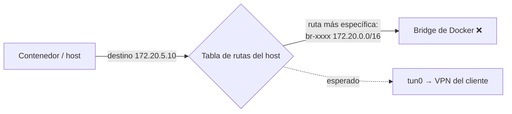

# Configuración del Daemon: daemon.json

Archivo: `/etc/docker/daemon.json` (Linux) o `C:\ProgramData\docker\config\daemon.json` (Windows). Si no existe, se crea. Un JSON inválido **impide que dockerd arranque**: validar siempre con `jq . /etc/docker/daemon.json` antes de reiniciar.

---

## Template para servidores

```json
{
  "default-address-pools": [
    { "base": "10.200.0.0/16", "size": 24 }
  ],
  "bip": "10.199.0.1/24",
  "log-driver": "json-file",
  "log-opts": { "max-size": "50m", "max-file": "3" },
  "live-restore": true,
  "metrics-addr": "127.0.0.1:9323",
  "registry-mirrors": ["https://registry-mirror.miorg.com"],
  "max-concurrent-downloads": 10,
  "max-concurrent-uploads": 10
}
```

| Clave | Para qué |
|-------|----------|
| `default-address-pools` | Rango del que Compose/`docker network create` toman subredes. **Ver abajo: evita romper VPNs.** |
| `bip` | IP/subred del bridge por defecto `docker0` (por defecto `172.17.0.1/16`) |
| `log-driver` + `log-opts` | Rotación por defecto para **todos** los contenedores nuevos. Sin esto, `json-file` crece sin límite |
| `live-restore` | Reiniciar/actualizar dockerd sin matar los contenedores |
| `metrics-addr` | Métricas del engine en formato Prometheus |
| `registry-mirrors` | Los pulls de Docker Hub pasan primero por un mirror (Nexus, Harbor) |

---

## Conflicto de subredes con VPNs y redes corporativas

Por defecto Docker asigna redes bridge desde `172.17.0.0/16` hasta `172.31.0.0/16` (y `192.168.0.0/16`). Si un cliente o datacenter alcanzable por VPN usa direcciones **172.16–172.31.x.x**, pasa esto:



El tráfico se va al bridge de Docker en vez de salir por `tun0`, y la conexión **falla en silencio** (timeouts, sin error claro).

Diagnóstico:

```bash
ip route get 172.20.5.10            # ¿sale por tun0 o por br-xxxx / docker0?
ip -4 addr show | grep -E 'docker0|br-'
docker network inspect $(docker network ls -q) --format '{{.Name}} {{range .IPAM.Config}}{{.Subnet}}{{end}}'
```

Soluciones (de menor a mayor impacto):

| Opción | Cuándo |
|--------|--------|
| `default-address-pools` + `bip` en un rango que nadie use (ej. `10.200.0.0/16`) | Siempre que el host hable con redes 172.16/12 |
| Subred explícita en el compose (`ipam.config.subnet`) | Un stack puntual |
| `network_mode: host` | El servicio necesita usar las rutas del host tal cual (ej. Jenkins que sale por varias VPNs). Ver [Networking avanzado](/article/docker/15-networking-avanzado-vpn-host/) |

> Cambiar `default-address-pools` solo afecta a redes **nuevas**. Las existentes hay que recrearlas: `docker compose down && docker compose up -d`.

---

## Exponer dockerd por TCP (solo localhost)

Algunas herramientas (Docker Cloud plugin de Jenkins, Portainer en otro host) necesitan `tcp://host:2375`. No se puede poner `"hosts"` en `daemon.json` si systemd ya pasa `-H fd://` (dockerd falla con *"directives are specified both as a flag and in the configuration file"*). Se usa un override:

```bash
sudo systemctl edit docker
```

```ini
[Service]
ExecStart=
ExecStart=/usr/bin/dockerd -H fd:// -H tcp://127.0.0.1:2375 --containerd=/run/containerd/containerd.sock
```

```bash
sudo systemctl daemon-reload && sudo systemctl restart docker
curl -s http://127.0.0.1:2375/version | jq .Version
```

> `2375` es la API **sin autenticación ni TLS**: equivale a root en el host. Nunca `0.0.0.0:2375`. Para acceso remoto usar `2376` con TLS mutuo o un agente (Portainer agent, SSH: `DOCKER_HOST=ssh://user@host`).

---

## Registry mirror

```json
{ "registry-mirrors": ["https://registry-mirror.miorg.com"] }
```

- Solo aplica a imágenes de **Docker Hub** (`nginx`, `library/...`). Imágenes de otros registries se piden con el nombre completo.
- El daemon **no** envía las credenciales de `docker login` al mirror: el mirror debe permitir pull anónimo. Si no, Docker cae a Docker Hub directo **sin avisar**.
- Verificar: `docker info | grep -A2 "Registry Mirrors"`.

Ver [Registry privado con Nexus](/article/docker/18-registry-privado-nexus/).

---

## Aplicar cambios

| Cambio | Cómo aplicarlo |
|--------|----------------|
| `log-opts`, `registry-mirrors`, `insecure-registries`, `live-restore`, `max-concurrent-*` | `sudo systemctl reload docker` (SIGHUP) |
| `default-address-pools`, `bip`, `data-root`, `storage-driver`, `metrics-addr` | `sudo systemctl restart docker` |

```bash
jq . /etc/docker/daemon.json && sudo systemctl restart docker
sudo journalctl -u docker -n 50 --no-pager     # si no levanta
docker info                                     # confirmar la config efectiva
```

> Sin `live-restore`, un `restart` de docker **para todos los contenedores**; los que no tengan `restart: unless-stopped`/`always` quedan apagados. Hacerlo en ventana de mantenimiento.
