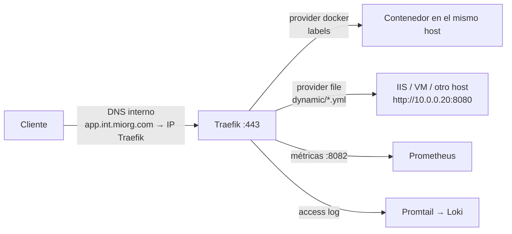

# Traefik v3 como Reverse Proxy

No todo necesita Kubernetes. Un host (o un par) con Docker Compose + Traefik delante resuelve TLS, ruteo por nombre y observabilidad para decenas de servicios internos.



---

## compose.yaml

```yaml
services:
  traefik:
    image: traefik:v3.1            # versión fija
    container_name: traefik
    restart: unless-stopped
    ports:
      - "80:80"
      - "443:443"
      - "8082:8082"                # métricas Prometheus
    environment:
      ACME_DNS_API_BASE: "https://auth.acme-dns.io"
      ACME_DNS_STORAGE_PATH: "/etc/traefik/acme-dns.json"
    volumes:
      - ./config/traefik.yml:/etc/traefik/traefik.yml:ro
      - ./config/dynamic:/etc/traefik/dynamic:ro
      - /etc/traefik/acme-dns.json:/etc/traefik/acme-dns.json   # secreto, fuera del repo
      - /var/run/docker.sock:/var/run/docker.sock:ro
      - traefik-certs:/etc/traefik/certs                        # acme.json persiste aquí

volumes:
  traefik-certs:
    name: traefik-certs
```

> Si el archivo montado como bind (`/etc/traefik/acme-dns.json`) **no existe** en el host, Docker crea un **directorio** con ese nombre y Traefik falla con `is a directory`. Crear el archivo antes del primer `up`.

---

## Configuración estática (`traefik.yml`)

```yaml
api:
  dashboard: true

ping:
  manualRouting: true          # exponer ping@internal en un router propio

entryPoints:
  web:
    address: ":80"
    http:
      redirections:
        entryPoint: { to: websecure, scheme: https }
  websecure:
    address: ":443"
  metrics:
    address: ":8082"
  tcp-5555:                    # entrypoints TCP crudos también son posibles
    address: ":5555"

providers:
  docker:
    exposedByDefault: false    # solo contenedores con traefik.enable=true
  file:
    directory: /etc/traefik/dynamic
    watch: true                # recarga en caliente al cambiar los .yml

certificatesResolvers:
  letsencrypt:
    acme:
      storage: /etc/traefik/certs/acme.json
      dnsChallenge:
        provider: acme-dns
        resolvers: ["1.1.1.1:53", "1.0.0.1:53"]   # DNS público, no el split-horizon interno

log:
  level: INFO
accessLog: {}

metrics:
  prometheus:
    entryPoint: metrics
    addEntryPointsLabels: true
    addRoutersLabels: true
    addServicesLabels: true
```

---

## Provider Docker: labels

Para contenedores en el mismo host:

```yaml
services:
  grafana:
    image: grafana/grafana:11.2.0
    labels:
      - "traefik.enable=true"
      - "traefik.http.routers.grafana.rule=Host(`grafana.int.miorg.com`)"
      - "traefik.http.routers.grafana.entrypoints=websecure"
      - "traefik.http.routers.grafana.tls.certresolver=letsencrypt"
      - "traefik.http.services.grafana.loadbalancer.server.port=3000"
    networks: [proxy]

networks:
  proxy:
    external: true
```

---

## Provider File: backends fuera de Docker

Para IIS, VMs, otros hosts Docker o servicios con `network_mode: host`. Un archivo por dominio/grupo en `config/dynamic/`:

```yaml
# config/dynamic/apps-internas.yml
http:
  routers:
    jenkins:
      rule: "Host(`jenkins.int.miorg.com`)"
      entryPoints: [websecure]
      service: jenkins-svc
      tls:
        certResolver: letsencrypt
        domains:
          - main: "int.miorg.com"
            sans: ["*.int.miorg.com"]

    vault:
      rule: "Host(`vault.int.miorg.com`)"
      entryPoints: [websecure]
      service: vault-svc
      tls: { certResolver: letsencrypt }

  services:
    jenkins-svc:
      loadBalancer:
        servers:
          - url: "http://10.0.0.21:8080"
    vault-svc:
      loadBalancer:
        serversTransport: skip-verify
        servers:
          - url: "https://10.0.0.22:8200"     # backend con TLS propio (self-signed)

  serversTransports:
    skip-verify:
      insecureSkipVerify: true
```

### Certificados propios (no ACME)

```yaml
# config/dynamic/main.yml
tls:
  certificates:
    - certFile: /etc/traefik/certs/miorg.pem
      keyFile:  /etc/traefik/certs/miorg-key.pem
```

Traefik elige el certificado por SNI. **Si ya tiene un certificado que cubre el dominio, no pide uno ACME** para ese dominio.

---

## Certificados wildcard con ACME DNS-01 (sin exponer nada)

Para servicios **internos** que no son alcanzables desde internet, HTTP-01/TLS-ALPN no sirven. DNS-01 sí: se prueba el control del dominio publicando un TXT.

```text
                     (1) pide *.int.miorg.com
Traefik ──────────────────────────────────────► Let's Encrypt
   │ (2) escribe TXT en acme-dns                   │ (3) consulta _acme-challenge.int.miorg.com
   ▼                                               ▼
auth.acme-dns.io ◄──── CNAME fijo (DNS público) ── _acme-challenge.int.miorg.com
                     (4) TXT ok → emite el wildcard
```

- Con **acme-dns** no hace falta un token de la API del DNS: se crea **un único CNAME fijo** `_acme-challenge.<dominio>` → `<uuid>.auth.acme-dns.io` y Traefik solo escribe en acme-dns.
- Si se tiene un token del proveedor DNS (ej. Cloudflare con `Zone:DNS:Edit` limitado a la zona), usar `provider: cloudflare` + `CF_DNS_API_TOKEN` en un `env_file`.
- El wildcard cubre **un nivel**: `app.int.miorg.com` sí, `x.app.int.miorg.com` no.
- Renovación automática ~30 días antes del vencimiento. **No borrar `acme.json`** (fuerza reemisión y puede pegar contra rate limits).

Registrar la cuenta de acme-dns:

```bash
sudo mkdir -p /etc/traefik
curl -s -X POST https://auth.acme-dns.io/register \
  | python3 -c 'import json,sys; print(json.dumps({"int.miorg.com": json.load(sys.stdin)}, indent=2))' \
  | sudo tee /etc/traefik/acme-dns.json >/dev/null
sudo chmod 600 /etc/traefik/acme-dns.json
# Crear el CNAME _acme-challenge.int.miorg.com → <fulldomain> en el DNS público
```

---

## Middlewares frecuentes

```yaml
http:
  middlewares:
    strip-app:
      stripPrefix:
        prefixes: ["/bowasui"]

    root-to-dashboard:
      redirectRegex:
        regex: "^https://traefik\\.int\\.miorg\\.com/?$"
        replacement: "https://traefik.int.miorg.com/dashboard/"

    sso:                                  # autenticación delegada (Authentik, Authelia, oauth2-proxy)
      forwardAuth:
        address: "http://authentik-server:9000/outpost.goauthentik.io/auth/traefik"
        trustForwardHeader: true
        authResponseHeaders: ["X-Authentik-Username", "X-Authentik-Groups", "X-Authentik-Email"]

    big-uploads:                          # uploads de hasta ~1 GB
      buffering:
        maxRequestBodyBytes: 1000000000
        memRequestBodyBytes: 1000000000

    websocket-headers:
      headers:
        customRequestHeaders:
          X-Forwarded-Proto: "https"
```

> **No** aplicar `buffering` a routers de un registry Docker: corta el push de capas grandes.

### Por path vs por subdominio

| Por path (`PathPrefix(/app)` + `stripPrefix`) | Por subdominio (`Host(app.dominio)`) |
|-----------------------------------------------|--------------------------------------|
| Un solo DNS | Un registro DNS por app (o wildcard) |
| La app debe tolerar estar bajo un prefijo (assets, redirects) | La app vive en `/`, sin middlewares |
| Fácil al inicio | Más limpio a largo plazo; requerido por registries Docker (`/v2/` en la raíz) |

---

## Dashboard y healthcheck

```yaml
http:
  routers:
    dashboard:
      rule: "Host(`traefik.int.miorg.com`)"
      entryPoints: [websecure]
      service: api@internal
      middlewares: [sso]
      tls: { certResolver: letsencrypt }
    heartbeat:
      rule: "PathPrefix(`/api/heartbeat`)"
      entryPoints: [web, websecure]
      service: ping@internal
      priority: 150
```

---

## Logs a Loki con Promtail

```yaml
  promtail:
    image: grafana/promtail:3.1.1
    volumes:
      - ./config/promtail-config.yml:/etc/promtail/promtail-config.yml:ro
      - /var/run/docker.sock:/var/run/docker.sock:ro
    command: -config.file=/etc/promtail/promtail-config.yml
```

```yaml
# promtail-config.yml
clients:
  - url: http://loki.int.miorg.com:3100/loki/api/v1/push
scrape_configs:
  - job_name: traefik-logs
    docker_sd_configs:
      - host: unix:///var/run/docker.sock
    relabel_configs:
      - source_labels: ['__meta_docker_container_name']
        regex: '/.*traefik.*'
        action: keep
      - source_labels: ['__meta_docker_container_name']
        regex: '/(.+)'
        target_label: 'container_name'
```

---

## Verificación y troubleshooting

```bash
# Qué certificado sirve Traefik para un nombre
echo | openssl s_client -connect 10.0.0.10:443 -servername app.int.miorg.com 2>/dev/null \
  | openssl x509 -noout -issuer -subject -dates

docker logs traefik 2>&1 | grep -iE "acme|certificate|error" | tail -20
curl -s http://localhost:8082/metrics | grep traefik_router_requests_total | head
```

| Síntoma | Causa |
|---------|-------|
| Navegador muestra `TRAEFIK DEFAULT CERT` | No hay cert para ese SNI: emisión ACME fallida o router sin `tls` |
| `404 page not found` | Ningún router matchea: `Host()` mal escrito, entrypoint equivocado, o `traefik.enable` faltante |
| `502 Bad Gateway` | Backend caído/inalcanzable, puerto mal, o backend HTTPS sin `serversTransport` |
| `unauthorized` / `incorrect TXT record` en ACME | Credenciales de acme-dns no corresponden al CNAME |
| `timeout` hacia `acme-v02.api.letsencrypt.org` | El host no tiene salida a internet |
| `413` subiendo archivos | Falta middleware `buffering`, o un proxy/CDN delante limita el tamaño |
| Cambios en `dynamic/` no aplican | `watch: true` faltante, o se montó un **archivo** (inode cambia al editar) en vez del **directorio** |
