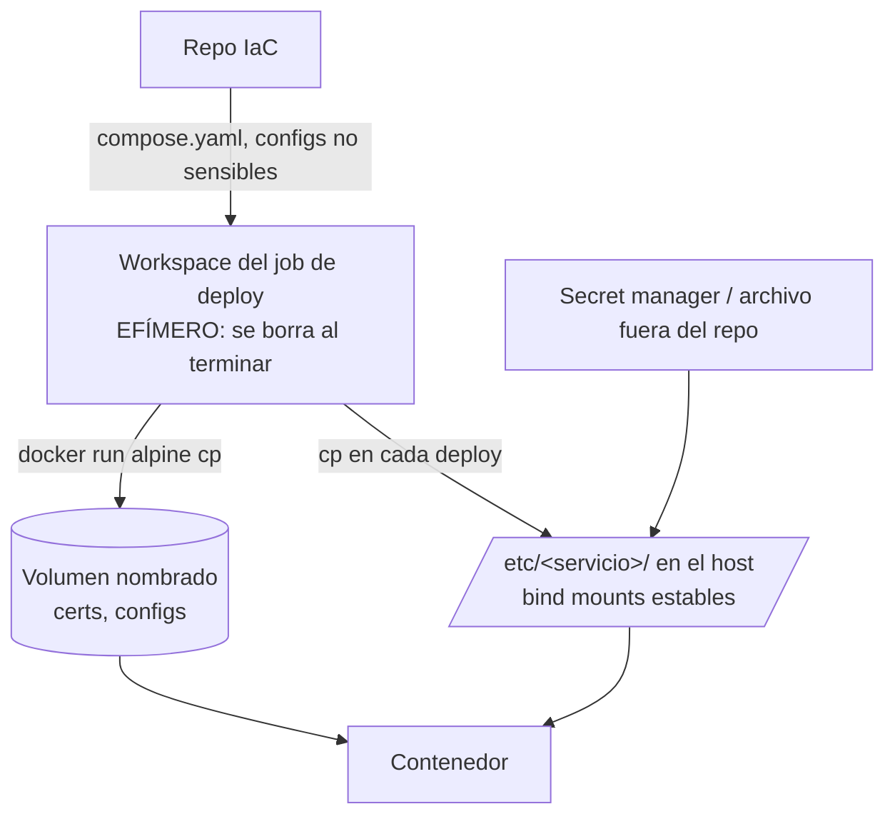

# Estándar para Servicios Docker Compose

Cuando un repo de infraestructura llega a 20+ stacks (Traefik, Vault, Nexus, SonarQube, monitoreo, DNS, apps internas), la diferencia entre "funciona" y "se puede operar" es la **consistencia**.

---

## Estructura de carpetas

```text
iac/src/<org>/docker/docker-compose/
├── traefik/
│   ├── compose.yaml
│   ├── README.md
│   └── config/
│       ├── traefik.yml
│       └── dynamic/*.yml
├── vault/
│   ├── compose.yaml
│   └── config/
│       ├── .env               ← variables no sensibles (o plantilla)
│       └── config.hcl
├── prometheus-grafana/
│   ├── compose.yaml
│   ├── grafana/Dockerfile     ← imagen propia cuando hace falta
│   └── prometheus/config/...
└── <servicio>/...
common/
├── keys/                      ← certificados (idealmente migrar a Vault)
└── assets/                    ← logos, archivos compartidos
```

| Regla | Motivo |
|-------|--------|
| Una carpeta por servicio, nombre = proyecto Compose | `docker compose -p <nombre>` y los labels `com.docker.compose.project` coinciden con la carpeta |
| `compose.yaml` (nombre moderno) | Evita ambigüedad con `docker-compose.yml` legacy |
| `README.md` por servicio | Puertos, DNS, cómo se deploya, troubleshooting propio |
| Config en `config/`, nunca inline gigante en el compose | Diffs legibles |

---

## Plantilla base

```yaml
name: mi-servicio

services:
  mi-servicio:
    image: vendor/mi-servicio:1.4.2       # versión fija, nunca :latest
    container_name: mi-servicio
    labels:
      org.label-schema.group: "devops"    # agrupar/filtrar: docker ps --filter label=...
    ports:
      - "8085:8080"
    env_file:
      - ./config/.env
    volumes:
      - mi-servicio-data:/data            # datos persistentes → volumen nombrado
      - /etc/mi-servicio/app.conf:/etc/app/app.conf:ro   # config → ruta estable del host
    mem_limit: 2g
    cpus: 2
    restart: unless-stopped
    healthcheck:
      test: ["CMD", "curl", "-fsS", "http://localhost:8080/health"]
      interval: 30s
      timeout: 5s
      retries: 3
    logging:
      driver: json-file
      options: { max-size: "50m", max-file: "3" }
    networks: [backend]

networks:
  backend:

volumes:
  mi-servicio-data:
    name: mi-servicio-data                # nombre fijo, sin prefijo del proyecto
```

### Decisiones de la plantilla

| Elemento | Recomendación |
|----------|---------------|
| `image` | Tag exacto (`postgres:17.4`, `traefik:v3.1`). `:latest` hace que un `up --pull always` cambie de versión mayor sin aviso |
| `restart` | `unless-stopped` (respeta un `docker stop` manual). `always` solo para agentes que deben volver sí o sí |
| Recursos | `mem_limit`/`cpus` evitan que un servicio (JVMs: Jenkins, Nexus, SonarQube) se coma el host |
| Volúmenes | `name:` explícito cuando otro proceso (backup, deploy) lo referencia por nombre |
| Dependencias | `depends_on` + `condition: service_healthy` (ej. SonarQube espera a Postgres con `pg_isready`) |
| `version:` | Obsoleto en Compose v2; se puede omitir |

---

## Dónde vive cada cosa



| Tipo | Dónde | Por qué |
|------|-------|---------|
| Datos de la app (DB, uploads, índices) | Volumen nombrado | Sobrevive a redeploys; backup con `docker run ... tar` |
| Config versionada (`Corefile`, `config.hcl`, `traefik.yml`) | Repo → copiada a `/etc/<servicio>/` en cada deploy | Ver advertencia abajo |
| Certificados | Volumen nombrado cargado en el deploy, o Vault | No dejarlos sueltos en el host ni en el workspace |
| Secretos | Archivo en el host (`chmod 600`), `env_file` fuera del repo, o Vault | **Nunca** en `compose.yaml` ni en `.env` commiteado |

> **Bind mounts al workspace de CI = bomba de tiempo.** Si el compose monta `./config/archivo` y el deploy corre desde un workspace de Jenkins que luego se limpia (`cleanWs()`), el contenedor funciona… hasta el próximo reinicio del host o del daemon, donde falla al montar (`Exited (127)`, `no such file`). Copiar siempre la config a una ruta estable (`/etc/<servicio>/`) o a un volumen.

### Cargar archivos en un volumen sin entrar al host

```bash
docker volume create traefik-certs
docker run --rm \
  -v "$PWD/common/keys/miorg.pem:/src/miorg.pem:ro" \
  -v "$PWD/common/keys/miorg-key.pem:/src/miorg-key.pem:ro" \
  -v traefik-certs:/dest \
  alpine sh -c "cp /src/*.pem /dest/"
```

Convertir un PFX a JKS directamente dentro de un volumen (servicios Java):

```bash
docker run --rm \
  -v "$PWD/cert.pfx:/tmp/in.pfx:ro" -v nexus-keys:/dest \
  eclipse-temurin:17-jdk \
  keytool -importkeystore -srckeystore /tmp/in.pfx -srcstoretype PKCS12 -srcstorepass "$PFX_PASS" \
          -destkeystore /dest/keystore.jks -deststoretype JKS -deststorepass "$JKS_PASS" -noprompt
```

---

## SOP: alta de un servicio nuevo

**1. Datos necesarios**
- Nombre del servicio e imagen con versión exacta
- Puertos, variables de entorno, volúmenes persistentes
- Dependencias (DB, Redis) y si necesita TLS / nombre DNS
- Host destino y límites de recursos

**2. Crear la carpeta** con `compose.yaml`, `config/` y `README.md` (copiar la plantilla).

**3. Exponerlo**
- Router + service en Traefik (`config/dynamic/*.yml` o labels) → [Traefik](/article/docker/11-standalone-deployments/)
- Registro en el DNS interno → [CoreDNS split-horizon](/article/docker/16-dns-interno-coredns/)

**4. Secretos** fuera del repo (Vault / archivo en el host). Si hay certificados, cargarlos a un volumen en el deploy.

**5. Deploy** por el pipeline estándar, no a mano en el host → [Deploy de Compose con Jenkins](/article/docker/14-deploy-compose-con-jenkins/).

**6. Observabilidad**: target en Prometheus/Blackbox, logs con rotación, alerta mínima de "down".

**7. Checklist**

- [ ] Imagen con versión específica (no `:latest`)
- [ ] Sin credenciales en `compose.yaml` ni en archivos commiteados
- [ ] `restart: unless-stopped`
- [ ] Datos en volúmenes nombrados; configs en rutas estables, no en el workspace
- [ ] `mem_limit`/`cpus` definidos para servicios pesados
- [ ] Healthcheck definido
- [ ] Rotación de logs (default del daemon o por servicio)
- [ ] README con puertos, DNS, deploy y backup
- [ ] `docker compose -f compose.yaml config` sin errores
- [ ] Arranca y `docker compose logs -f` limpio
