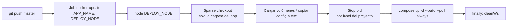

# Deploy y Migración de Stacks Compose con Jenkins

Principio: **nadie hace `docker compose up` a mano en un servidor**. Cambio → commit/push a `master` → job de deploy con `APP_NAME`. El repo es la fuente de verdad y el historial de builds es la auditoría.



---

## Pipeline genérico

```groovy
timeout(time: 10, unit: 'MINUTES') {
  timestamps {
    // Apps cuyo deploy debe ir a varios nodos, en orden. Si el primero falla se aborta:
    // el segundo sigue con la versión anterior y nunca caen los dos a la vez.
    def FIXED_NODES = [ 'coredns': ['DOCKER-01', 'DOCKER-02'] ]

    def appName     = params.APP_NAME.trim()
    def targetNodes = FIXED_NODES[appName] ?: [params.DEPLOY_NODE.trim()]
    def composeRel  = "docker/docker-compose/${appName}/compose.yaml"
    currentBuild.displayName = "${appName}#${targetNodes.join('+')}"

    for (targetNode in targetNodes) {
      node(targetNode) {
        try {
          stage('Sparse Checkout') {
            cleanWs()   // un .git viejo de otro APP_NAME deja archivos sin materializar
            sh """
              git init
              git remote add origin git@github.com:miorg/iac.git
              git config core.sparseCheckout true
              printf "docker/docker-compose/${appName}/\\ncommon/\\n" > .git/info/sparse-checkout
              git pull --depth=1 origin master
            """
          }

          stage('Load Volumes') {
            switch (appName) {
              case 'traefik':
                sh '''
                  docker volume create traefik-certs || true
                  docker run --rm -v "$PWD/common/keys:/src:ro" -v traefik-certs:/dest \
                    alpine sh -c "cp /src/*.pem /dest/"
                '''
                break
              case 'vault':
                sh '''
                  sudo mkdir -p /etc/vault
                  sudo cp docker/docker-compose/vault/config/config.hcl /etc/vault/config.hcl
                '''
                break
              default:
                echo "Sin volúmenes que cargar para ${appName}"
            }
          }

          stage('Stop old version') {
            sh """
              C=\$(docker ps -aq --filter "label=com.docker.compose.project=${appName}")
              [ -n "\$C" ] && docker stop \$C && docker rm \$C
              N=\$(docker network ls -q --filter "label=com.docker.compose.project=${appName}")
              [ -n "\$N" ] && docker network rm \$N || true
            """
          }

          stage('Start new version') {
            sh "docker compose -f ${composeRel} -p ${appName} up -d --build --pull always"
          }
        } finally {
          cleanWs()
        }
      }
    }
  }
}
```

### Por qué cada paso

| Paso | Detalle |
|------|---------|
| **Sparse checkout** `--depth=1` | Solo baja la carpeta del app + `common/`. Rápido aunque el repo tenga años de historia y binarios |
| `cleanWs()` **antes** del checkout | El mismo job se reutiliza para distintos `APP_NAME`; un `.git` residual hace que `git pull` diga *"Already up to date"* sin materializar los paths nuevos del sparse-checkout |
| **Stop por label** | `com.docker.compose.project=<nombre>` encuentra los contenedores aunque el compose haya cambiado (servicios renombrados/eliminados) — más robusto que `compose down` con el archivo nuevo |
| `-p <proyecto>` explícito | El nombre del proyecto no puede contener `/`; para carpetas anidadas usar un alias (`TerminalBE` → path `Lotteries/PLS/Terminal/TBE`, proyecto `tbe`) |
| `--pull always` | Trae la imagen del tag aunque exista localmente (parches de seguridad del mismo tag). Con tags fijos es seguro |
| `--build` | Reconstruye servicios con `build:` (imágenes propias) |
| `finally: cleanWs()` | Por eso **ninguna** config debe quedar montada desde el workspace (ver [Estándar](/article/docker/13-estandar-servicios-compose/)) |

### Generar `.env` en el deploy

Valores dependientes del host se calculan en el job y Compose los lee de `.env` junto al compose:

```bash
DNS_BIND_IP=$(ip -4 route get 1.1.1.1 | awk '{for(i=1;i<=NF;i++) if($i=="src"){print $(i+1); exit}}')
echo "DNS_BIND_IP=$DNS_BIND_IP" > docker/docker-compose/coredns/.env
```

```yaml
ports:
  - "${DNS_BIND_IP:?DNS_BIND_IP no definido}:53:53/udp"   # :? → falla explícito si falta
```

### Dockerfile fuera del contexto de build

`docker compose --build` (buildx bake) no resuelve bien un `dockerfile:` fuera del `context`. Si el contexto vive en el host (ej. `/opt/app/`) y el Dockerfile en el repo, **copiar** el Dockerfile al contexto antes del `up`.

---

## Migrar un stack entre hosts

Job complementario `docker-migrate` (`APP_NAME`, `SOURCE_NODE`, `TARGET_NODE`). Descubre los mounts automáticamente inspeccionando los contenedores del proyecto:

```bash
for c in $(docker ps -aq --filter "label=com.docker.compose.project=$APP"); do
  docker inspect "$c" --format '{{range .Mounts}}{{.Type}}|{{.Name}}|{{.Source}}|{{.Destination}}{{"\n"}}{{end}}'
done | sort -u
```

| Tipo de mount | Qué hacer |
|---------------|-----------|
| `volume` | Exportar con `tar` y recrear en el destino con el **mismo nombre** |
| `bind` dentro de la carpeta del compose (`./data`, `./config/dynamic`) | Copiar preservando la ruta relativa (data generada en runtime que no está en git) |
| `bind` fuera (`/var/run/docker.sock`, `/etc/...`, datasets enormes) | **No** migrar automático: listar como warning y resolver a mano |

```bash
# Origen: exportar un volumen
docker run --rm -v "$VOL:/data:ro" -v "$PWD:/backup" alpine tar czf "/backup/$VOL.tgz" -C /data .

# Destino: importar
docker volume create "$VOL"
docker run --rm -v "$VOL:/data" -v "$PWD:/backup" alpine tar xzf "/backup/$VOL.tgz" -C /data
```

Flujo: parar en origen (consistencia) → exportar → transferir → importar → `up` en destino con el mismo compose → validar → (opcional) borrar en origen.

> Transferir vía `stash/unstash` de Jenkins pasa por el controller (límite por defecto ~100 MB). Para bases de datos o métricas grandes, usar `rsync`/`rclone` directo entre nodos.

---

## Varios hosts: Portainer master + agentes

```yaml
# Master (UI) — un solo host
services:
  portainer:
    image: portainer/portainer-ce:2.21.0
    restart: always
    ports: ["9443:9443"]
    command: --sslcert /certs/cert.pem --sslkey /certs/privkey.pem
    volumes:
      - /var/run/docker.sock:/var/run/docker.sock
      - portainer_data:/data
      - portainer-certs:/certs
volumes:
  portainer_data:
  portainer-certs:
    name: portainer-certs
```

```yaml
# Agente — en cada host Docker
services:
  portainer_agent:
    image: portainer/agent:2.21.0         # misma versión que el master
    restart: always
    ports: ["9001:9001"]
    env_file: [./config/.env]             # AGENT_SECRET acá, no inline
    volumes:
      - /var/run/docker.sock:/var/run/docker.sock
      - /var/lib/docker/volumes:/var/lib/docker/volumes
```

> Portainer es para **observar y operar** (logs, exec, restart). Los cambios de configuración siguen yendo por el repo + pipeline; un stack editado desde la UI diverge del repo y se pisa en el próximo deploy.
