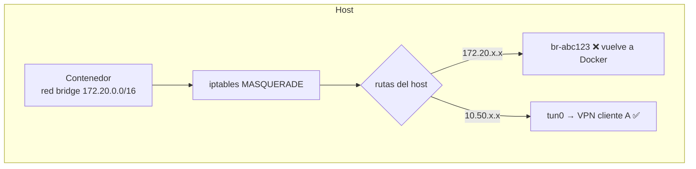

# Networking Avanzado en Docker

## 1. Contenedor que debe salir por VPNs del host

Escenario típico: un servidor (Jenkins, monitoreo, un agente de deploy) tiene túneles OpenVPN/IPsec hacia varios clientes o datacenters, y el servicio dockerizado tiene que alcanzarlos.

Con **bridge**, el tráfico del contenedor sale NATeado por el host y usa la tabla de rutas del host… **salvo** que el destino caiga dentro de una subred de Docker:



Si el cliente A usa `172.20.0.0/16` en su red, ese tráfico **nunca sale por `tun0`**: la ruta conectada del bridge gana. Síntomas: timeouts, `No route to host` intermitente según qué redes creó Docker ese día.

### Diagnóstico

```bash
ip route get 172.20.5.10                      # ¿dev tun0 o dev br-xxxx?
ip route | grep -E 'docker0|br-'
docker network ls -q | xargs docker network inspect -f '{{.Name}} {{(index .IPAM.Config 0).Subnet}}'

# Desde dentro del contenedor
docker exec -it app sh -c 'ip route; wget -qO- --timeout=5 http://172.20.5.10:8080 || echo FAIL'

# ¿Sale el paquete por la VPN?
sudo tcpdump -ni tun0 host 172.20.5.10
```

### Soluciones

| Opción | Pros | Contras |
|--------|------|---------|
| Mover los pools de Docker (`default-address-pools`, `bip`) a un rango libre — ver [daemon.json](/article/docker/08-daemon-json/) | Arregla todos los stacks | Hay que recrear redes; coordinar rangos con redes de clientes |
| `ipam` explícito en el compose | Puntual | Hay que acordarse en cada stack |
| `network_mode: host` | Usa las rutas del host **tal cual**, sin NAT ni subred propia | Pierde aislamiento de red; sin `ports:`; conflictos de puertos con el host |

```yaml
services:
  jenkins:
    image: miorg/jenkins:2.480-jdk17
    # host: Jenkins sale por las rutas OVPN del host hacia varios clientes cuyos
    # rangos 172.16-31.x.x pisan los pools por defecto de Docker.
    network_mode: host
    env_file: [./config/.env]
    mem_limit: 8g
    cpus: 4
    restart: unless-stopped
    volumes:
      - jenkins-home:/var/jenkins_home
```

> Con `network_mode: host`, `ports:` se ignora (el proceso escucha directo en el host) y `localhost` dentro del contenedor **es** el host. Útil, por ejemplo, para que Jenkins hable con `tcp://127.0.0.1:2375` del dockerd local.

> La VPN sigue gestionándose **en el host** (`systemctl enable --now openvpn@cliente-a`), no dentro del contenedor.

---

## 2. Publicar un puerto solo en una IP

```yaml
ports:
  - "10.0.0.10:8080:8080"          # solo en la IP LAN
  - "127.0.0.1:5432:5432"          # solo local (DB para un túnel SSH)
  - "8080:8080"                    # = 0.0.0.0:8080 + [::]:8080
```

> Docker inserta reglas en `iptables` (cadena `DOCKER`) **antes** que UFW/firewalld. Un `ufw deny 5432` no bloquea un puerto publicado por Docker. Publicar en `127.0.0.1` o usar la cadena `DOCKER-USER` para filtrar.

```bash
# Filtrar acceso a puertos publicados (persiste solo si se guarda con iptables-persistent)
sudo iptables -I DOCKER-USER -i eth0 ! -s 10.0.0.0/8 -p tcp --dport 9000 -j DROP
```

---

## 3. Puerto 53 ocupado (DNS en contenedor)

En Ubuntu/Debian con `systemd-resolved`, el stub escucha en `127.0.0.53:53`. Publicar `"53:53/udp"` (= `0.0.0.0:53`) falla:

```text
Error starting userland proxy: listen udp4 0.0.0.0:53: bind: address already in use
```

Opciones:

| Opción | Cómo |
|--------|------|
| **Publicar solo en la IP LAN** (recomendado) | `"${DNS_BIND_IP}:53:53/udp"` y `"${DNS_BIND_IP}:53:53/tcp"`, con `DNS_BIND_IP` calculado en el deploy |
| Desactivar el stub | `DNSStubListener=no` en `/etc/systemd/resolved.conf` + `systemctl restart systemd-resolved` (cambia la resolución del propio host) |

```bash
sudo ss -lunp | grep ':53 '
ip -4 route get 1.1.1.1 | awk '{for(i=1;i<=NF;i++) if($i=="src"){print $(i+1); exit}}'   # IP LAN principal
```

---

## 4. Resolver nombres internos desde contenedores

Los contenedores heredan `/etc/resolv.conf` del host (si el host usa `127.0.0.53`, Docker lo reemplaza por los upstream reales). Para forzar el DNS interno:

```yaml
services:
  app:
    dns: [10.0.0.53, 10.0.0.54]
    extra_hosts:
      - "ldap.corp.miorg.local:10.0.0.5"     # equivalente a /etc/hosts, sin modificar el comando
      - "host.docker.internal:host-gateway"  # IP del host desde el contenedor (Linux)
```

> Antipatrón: `command: sh -c "echo '10.0.0.5 ldap...' >> /etc/hosts && ..."`. Se pierde el entrypoint original y el cambio no es declarativo. Usar `extra_hosts`.

---

## 5. Comunicación entre stacks

```yaml
# Stack A crea/usa la red compartida
networks:
  proxy:
    name: proxy
    external: true      # creada antes: docker network create proxy
```

Todos los stacks que tengan que ser alcanzados por Traefik se unen a `proxy`; cada uno mantiene además su red interna (`backend`) para DB/cache, que **no** se expone.

---

## Comandos de diagnóstico

```bash
docker network inspect proxy --format '{{range .Containers}}{{.Name}} {{.IPv4Address}}{{"\n"}}{{end}}'
docker run --rm --network container:app nicolaka/netshoot dig db
docker run --rm --network container:app nicolaka/netshoot curl -sv http://backend:8080/health
docker run --rm --net host nicolaka/netshoot ss -lntup
sudo iptables -t nat -L DOCKER -n --line-numbers
```

`nicolaka/netshoot` trae `dig`, `curl`, `tcpdump`, `iperf`, `ss`, `mtr`: compartir el namespace de red de otro contenedor (`--network container:<x>`) permite depurar imágenes distroless que no tienen ni `sh`.
