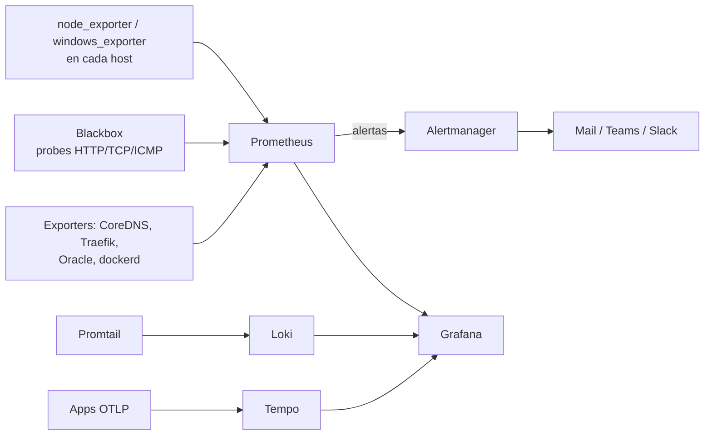

# Stack de Monitoreo en Compose



---

## compose.yaml

```yaml
name: monitoring

services:
  prometheus:
    image: prom/prometheus:v2.54.1
    container_name: prometheus
    restart: unless-stopped
    ports: ["9090:9090"]
    command:
      - --config.file=/etc/prometheus/prometheus.yml
      - --storage.tsdb.path=/prometheus
      - --storage.tsdb.retention.time=30d
      - --storage.tsdb.retention.size=20GB      # lo que llegue primero
      - --web.enable-lifecycle                  # habilita POST /-/reload
    volumes:
      - prometheus-data:/prometheus
      - prometheus-config:/etc/prometheus:ro
    networks: [monitor-net]

  grafana:
    build: ./grafana                            # imagen propia con grafana.ini
    image: miorg/grafana:11.2.0
    container_name: grafana
    restart: unless-stopped
    ports: ["3000:3000"]
    env_file: [./config/grafana.env]            # GF_SECURITY_ADMIN_PASSWORD fuera del repo
    environment:
      - GF_SERVER_PROTOCOL=https
      - GF_SERVER_CERT_FILE=/etc/grafana-tls/cert.pem
      - GF_SERVER_CERT_KEY=/etc/grafana-tls/key.pem
      - GF_INSTALL_PLUGINS=grafana-athena-datasource
    volumes:
      - grafana-data:/var/lib/grafana
      - grafana-plugins:/var/lib/grafana/plugins
      - /etc/grafana-tls:/etc/grafana-tls:ro
    networks: [monitor-net]

  alertmanager:
    image: prom/alertmanager:v0.27.0
    container_name: alertmanager
    restart: unless-stopped
    ports: ["9093:9093"]
    command:
      - --config.file=/etc/alertmanager/alertmanager.yml
      - --storage.path=/alertmanager
    volumes:
      - alertmanager-data:/alertmanager
      - alertmanager-config:/etc/alertmanager:ro
    networks: [monitor-net]

  loki:
    image: grafana/loki:3.1.1
    container_name: loki
    restart: unless-stopped
    ports: ["3100:3100"]
    volumes: [loki-data:/loki]
    networks: [monitor-net]

  tempo:
    image: grafana/tempo:2.6.0
    container_name: tempo
    restart: unless-stopped
    ports: ["4317:4317", "4318:4318"]           # OTLP gRPC / HTTP
    command: ["-config.file=/etc/tempo/tempo.yml"]
    volumes:
      - tempo-data:/var/tempo
      - tempo-config:/etc/tempo:ro
    networks: [monitor-net]

  blackbox:
    build: ./blackbox
    image: miorg/blackbox-exporter:v0.25.0
    container_name: blackbox
    restart: unless-stopped
    ports: ["9115:9115"]
    networks: [monitor-net]

networks:
  monitor-net:

volumes:
  prometheus-data:
  prometheus-config:
  grafana-data:
  grafana-plugins:
  alertmanager-data:
  alertmanager-config:
  loki-data:
  tempo-data:
  tempo-config:
```

### Config en volúmenes nombrados, sincronizada en el deploy

En lugar de bind mounts al workspace de CI, el job copia la config del repo al volumen en cada deploy:

```bash
docker volume create monitoring_prometheus-config
docker run --rm \
  -v "$PWD/prometheus/config:/src:ro" \
  -v monitoring_prometheus-config:/dest \
  alpine sh -c "rm -rf /dest/* && cp -r /src/. /dest/"
```

`rm -rf /dest/*` garantiza que un archivo borrado en el repo también desaparezca del volumen.

### Imágenes propias "config-baked"

Para servicios cuya config cambia poco (Grafana, Loki, Blackbox), un Dockerfile mínimo la hornea en la imagen:

```dockerfile
FROM prom/blackbox-exporter:v0.25.0
COPY ./config/blackbox.yml /etc/blackbox/blackbox.yml
ENTRYPOINT ["/bin/blackbox_exporter"]
CMD ["--config.file=/etc/blackbox/blackbox.yml"]
```

Se aplica con `docker compose up -d --build`.

---

## Organización de targets

Con muchos clientes/datacenters, un `prometheus.yml` monolítico se vuelve inmanejable. `scrape_config_files` (Prometheus ≥ 2.43) permite partirlo:

```yaml
# prometheus.yml
global:
  scrape_interval: 1m
  evaluation_interval: 1m

alerting:
  alertmanagers:
    - static_configs:
        - targets: ['alertmanager:9093']

rule_files:
  - 'alert-rules.yml'

scrape_config_files:
  - 'internal/*.yml'
  - 'clientes/cliente-a/*.yml'
  - 'clientes/cliente-b/*.yml'
  - 'blackbox/*.yml'
```

```yaml
# internal/hosts-linux.yml
scrape_configs:
  - job_name: node-linux
    file_sd_configs:
      - files: ['/etc/prometheus/targets_lin.yml']
```

```yaml
# targets_lin.yml — se edita sin tocar la config de jobs
- targets: ['10.0.0.10:9100']
  labels: { nick: 'DOCKER-01', team: 'DevOps' }
- targets: ['10.0.0.11:9100']
  labels: { nick: 'DOCKER-02', team: 'DevOps' }
```

> El label `nick` (nombre humano del host) hace que alertas y dashboards sean legibles sin memorizar IPs.

### Blackbox: probes HTTP

```yaml
scrape_configs:
  - job_name: blackbox-qa-services
    metrics_path: /probe
    params: { module: [http_2xx] }
    static_configs:
      - targets: ['https://app-qa.miorg.com/health', 'https://api-qa.miorg.com/ping']
    relabel_configs:
      - source_labels: [__address__]
        target_label: __param_target
      - source_labels: [__param_target]
        target_label: instance
      - target_label: __address__
        replacement: blackbox:9115
```

---

## Alertas de ejemplo

```yaml
groups:
  - name: services
    rules:
      - alert: ServiceDown
        expr: probe_success{job="blackbox-qa-services"} < 1
        for: 1m
        labels: { severity: warning }
        annotations:
          summary: "{{ $labels.instance }} DOWN"

  - name: coredns
    rules:
      - alert: CoreDNSDown
        expr: up{job="coredns"} < 1
        for: 2m
        labels: { severity: warning }
        annotations:
          description: "{{ $labels.nick }} no responde: los clientes resuelven solo con el otro nodo."
      - alert: CoreDNSAllDown
        expr: sum(up{job="coredns"}) < 1
        for: 1m
        labels: { severity: critical }
      - alert: CoreDNSUpstreamFailing
        expr: increase(coredns_forward_healthcheck_broken_total[5m]) > 0
        labels: { severity: warning }

  - name: hosts
    rules:
      - alert: DiskAlmostFull
        expr: (node_filesystem_avail_bytes{fstype!~"tmpfs|overlay"} / node_filesystem_size_bytes) < 0.10
        for: 15m
        labels: { severity: warning }
```

Validar antes de deployar:

```bash
docker run --rm -v "$PWD/prometheus/config:/cfg" --entrypoint promtool prom/prometheus:v2.54.1 check config /cfg/prometheus.yml
docker run --rm -v "$PWD/prometheus/config:/cfg" --entrypoint promtool prom/prometheus:v2.54.1 check rules /cfg/alert-rules.yml
```

---

## Operación

```bash
# Recargar config/reglas sin reiniciar (requiere --web.enable-lifecycle)
curl -X POST http://localhost:9090/-/reload

# Estado de targets
curl -s localhost:9090/api/v1/targets | jq '.data.activeTargets[] | select(.health!="up") | {job:.labels.job, instance:.labels.instance, err:.lastError}'

# Uso de disco del TSDB
docker exec prometheus du -sh /prometheus

# Métricas del propio Docker (daemon.json: "metrics-addr": "127.0.0.1:9323")
curl -s localhost:9323/metrics | grep engine_daemon_container_states_containers
```

| Síntoma | Causa |
|---------|-------|
| `context deadline exceeded` en targets | `scrape_timeout` < tiempo real del exporter (Oracle/SQL lentos) o firewall |
| Prometheus reinicia por OOM | Demasiadas series / alta cardinalidad: revisar labels con IDs únicos; subir `mem_limit` |
| Grafana pierde dashboards tras redeploy | `/var/lib/grafana` no estaba en volumen, o dashboards no provisionados como código |
| Alertas no llegan | `amtool check-config`, rutas/receivers de Alertmanager, y que Prometheus apunte al Alertmanager correcto |

Backup del stack: volúmenes `grafana-data` (dashboards/usuarios) y, si interesa histórico, `prometheus-data` (usar `POST /api/v1/admin/tsdb/snapshot` con `--web.enable-admin-api` para un snapshot consistente).
