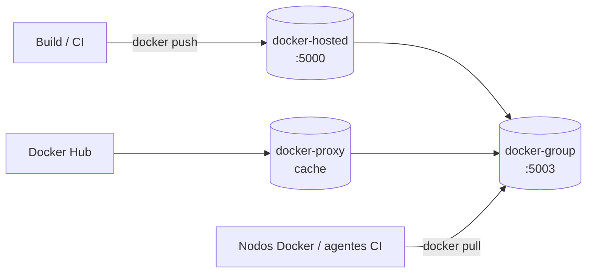

# Registry Privado con Nexus

Nexus Repository 3 centraliza artefactos de varios formatos: **Docker**, npm, Maven, NuGet, raw. Para Docker resuelve tres problemas: imágenes propias privadas, rate limit de Docker Hub y builds que dependen de internet.



| Repo | Tipo | Uso |
|------|------|-----|
| `docker-hosted` | hosted | `push`/`pull` de imágenes propias |
| `docker-proxy` | proxy → `https://registry-1.docker.io` | Cachea Docker Hub |
| `docker-group` | group (hosted + proxy) | **Un solo endpoint de pull** para todo. Solo lectura |

---

## compose.yaml

```yaml
services:
  nexus:
    image: sonatype/nexus3:3.72.0           # versión fija: upgrades de Nexus migran la DB interna
    container_name: nexus
    restart: unless-stopped
    ports:
      - "8081:8081"                         # UI + repos HTTP (npm, maven, raw)
      - "5000:5000"                         # HTTP connector del repo docker-hosted
      - "5003:5003"                         # HTTP connector del repo docker-group
    environment:
      - INSTALL4J_ADD_VM_PARAMS=-Xms1200m -Xmx1200m -XX:MaxDirectMemorySize=2g -Djava.util.prefs.userRoot=/nexus-data/javaprefs
    volumes:
      - nexus-data:/nexus-data
    mem_limit: 4g

volumes:
  nexus-data:
    name: nexus-data
```

Password inicial de admin: `docker exec nexus cat /nexus-data/admin.password`.

### Configuración en la UI

1. **Repositories → Create**: `docker (hosted)` con HTTP connector `5000`; `docker (proxy)` a Docker Hub; `docker (group)` con HTTP connector `5003` que incluya ambos.
2. **Security → Realms**: activar **Docker Bearer Token Realm**.
3. Para usarlo como mirror: **Security → Anonymous Access** habilitado y *Allow anonymous docker pull* en el group.
4. **System → Capabilities → Base URL**: `https://nexus.miorg.com` (para que los links generados usen el DNS).

---

## Un hostname por registry

El cliente Docker siempre pide `/v2/` en la **raíz** del host, así que no se pueden separar registries por path. Cada uno necesita su nombre DNS:

| DNS | Backend | Para qué |
|-----|---------|----------|
| `nexus.miorg.com` | `:8081` | UI, npm, Maven, raw |
| `nexus-registry.miorg.com` | `:5000` | `docker push` / `pull` de imágenes propias |
| `nexus-docker.miorg.com` | `:5003` | `docker pull` unificado (propias + Docker Hub) |

```yaml
# Traefik, config/dynamic/nexus.yml
http:
  routers:
    nexus-ui:
      rule: "Host(`nexus.miorg.com`)"
      entryPoints: [websecure]
      service: nexus-ui
      middlewares: [big-uploads]        # artefactos npm/raw grandes
      tls: {}
    nexus-registry:
      rule: "Host(`nexus-registry.miorg.com`)"
      entryPoints: [websecure]
      service: nexus-registry           # SIN buffering: corta capas grandes
      tls: {}
  services:
    nexus-ui:       { loadBalancer: { servers: [ { url: "http://10.0.0.10:8081" } ] } }
    nexus-registry: { loadBalancer: { servers: [ { url: "http://10.0.0.10:5000" } ] } }
```

---

## Uso

```bash
# Publicar
docker login nexus-registry.miorg.com
docker tag mi-app:1.4.2 nexus-registry.miorg.com/mi-app:1.4.2
docker push nexus-registry.miorg.com/mi-app:1.4.2

# Consumir (propias y Docker Hub por el mismo endpoint)
docker pull nexus-docker.miorg.com/mi-app:1.4.2
docker pull nexus-docker.miorg.com/library/nginx:1.27

# Listar tags (API Registry v2)
curl -s -u user https://nexus-registry.miorg.com/v2/mi-app/tags/list | jq
```

Otros formatos:

```ini
# .npmrc — scope privado
@miorg:registry=https://nexus.miorg.com/repository/npm-private/
```

```xml
<!-- ~/.m2/settings.xml -->
<mirror>
  <id>nexus</id>
  <mirrorOf>*</mirrorOf>
  <url>https://nexus.miorg.com/repository/maven-public/</url>
</mirror>
```

```bash
# raw
curl -u user --upload-file app.zip https://nexus.miorg.com/repository/raw-releases/app/1.0/app.zip
```

---

## Preparar un nodo Docker (script idempotente)

Un script con opciones independientes evita pasos manuales en cada host/agente:

```bash
#!/usr/bin/env bash
# setup-docker-node.sh [--mirror] [--restart] [--login --user jenkins] [--check]
set -euo pipefail
MIRROR="https://nexus-docker.miorg.com"
DAEMON_JSON=/etc/docker/daemon.json

add_mirror() {
  [ -f "$DAEMON_JSON" ] || echo '{}' > "$DAEMON_JSON"
  cp "$DAEMON_JSON" "$DAEMON_JSON.bak.$(date +%s)"
  tmp=$(mktemp)
  jq --arg m "$MIRROR" '."registry-mirrors" = ((."registry-mirrors" // []) + [$m] | unique)' "$DAEMON_JSON" > "$tmp"
  mv "$tmp" "$DAEMON_JSON"
}

login_as() {   # credenciales desde el entorno, nunca en el script
  sudo -u "$1" -H sh -c "echo \"\$NEXUS_PASS\" | docker login nexus-registry.miorg.com -u \"\$NEXUS_USER\" --password-stdin"
}

check() {
  for r in nexus-registry.miorg.com nexus-docker.miorg.com; do
    code=$(curl -s -o /dev/null -w '%{http_code}' "https://$r/v2/")
    [[ "$code" =~ ^(200|401)$ ]] && echo "OK  $r ($code)" || echo "FAIL $r ($code)"
  done
}
```

```bash
sudo ./setup-docker-node.sh --mirror --restart --check
sudo NEXUS_USER=ci NEXUS_PASS='***' ./setup-docker-node.sh --login --user jenkins
```

> `--login --user jenkins` deja el token en `~jenkins/.docker/config.json`: los builds del agente pueden pushear sin credenciales en el pipeline.

---

## Problemas típicos

| Síntoma | Causa / solución |
|---------|------------------|
| `413 Request Entity Too Large` en `docker push` | Proxy/CDN delante limita el body. Cloudflare con proxy (nube naranja) corta en 100 MB en planes Free/Pro → registro DNS en *DNS only*. En Traefik, no aplicar `buffering` al router del registry |
| Mirror configurado pero los pulls siguen yendo a Docker Hub | El daemon no manda credenciales al mirror: falta pull anónimo o el realm *Docker Bearer Token*. Docker cae a Hub **sin avisar** |
| `http: server gave HTTP response to HTTPS client` | Se accede al connector HTTP directo. Ir por Traefik (TLS) o agregar a `insecure-registries` (solo labs) |
| `unauthorized: access to the requested resource is not authorized` en push al group | El group es de solo lectura: pushear al hosted |
| `package-lock.json` sigue apuntando a `http://IP:8081` | Los lockfiles guardan la URL `resolved`; regenerarlos tras migrar a DNS |
| Nexus lento / OOM | Ajustar `-Xmx` y `MaxDirectMemorySize`; correr tareas de *Compact blob store* y *Cleanup policies* |

### Limpieza

En **Tasks** programar: *Docker - Delete unused manifests and images*, *Cleanup service* (con políticas por antigüedad/último descarga) y *Admin - Compact blob store*. Sin compactar, borrar componentes no libera disco.
