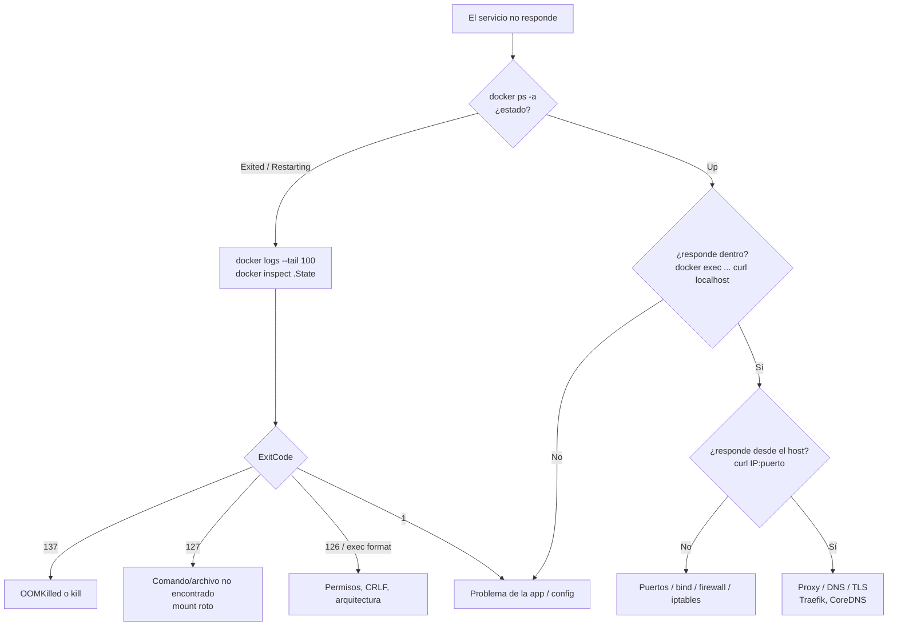

# Troubleshooting Docker en Producción

## Flujo de diagnóstico



---

## Comandos base

```bash
docker ps -a --format 'table {{.Names}}\t{{.Status}}\t{{.Image}}'
docker inspect app --format '{{json .State}}' | jq
docker inspect app --format '{{.RestartCount}} restarts, OOMKilled={{.State.OOMKilled}}'
docker logs app --since 30m --tail 200 -t
docker events --since 1h --filter container=app
docker stats --no-stream
docker inspect app --format '{{range .Mounts}}{{.Type}} {{.Source}} -> {{.Destination}}{{"\n"}}{{end}}'
docker compose -f compose.yaml config          # compose resuelto (env, defaults)
```

---

## Contenedor que no arranca o se reinicia

| Síntoma | Causa | Fix |
|---------|-------|-----|
| `Exited (127)` tras reinicio del host | Bind mount a un path que ya no existe (ej. workspace de CI limpiado) | Configs en rutas estables (`/etc/<svc>/`) o volúmenes. Ver [Estándar Compose](/article/docker/13-estandar-servicios-compose/) |
| `is a directory` / `not a directory` | Se montó un archivo inexistente → Docker creó un **directorio** en el host | `rm -r` del directorio, crear el archivo, `up -d` |
| `Exited (137)`, `OOMKilled=true` | Superó `mem_limit` (JVMs típicamente) | Subir `mem_limit` o bajar `-Xmx` (dejar ~25% de margen para memoria no-heap) |
| `exec format error` | Script con CRLF, sin shebang, o imagen de otra arquitectura (arm64 vs amd64) | `sed -i 's/\r$//'`; `docker image inspect --format '{{.Architecture}}'` |
| `permission denied` en el volumen | UID del proceso ≠ dueño de los archivos (ej. imagen oficial Jenkins = uid 1000) | `chown -R 1000:1000` sobre el mountpoint del volumen |
| Restart loop sin logs útiles | El entrypoint falla antes de loguear | `docker run --rm -it --entrypoint sh imagen` y ejecutar a mano |
| App arranca pero dependencia no lista | `depends_on` sin condición | `condition: service_healthy` + `healthcheck` en la dependencia |
| SonarQube/Elasticsearch muere al iniciar | `vm.max_map_count` bajo en el host | `sysctl -w vm.max_map_count=524288` y persistir |
| Dos versiones de un plugin → no arranca | El volumen conserva el jar viejo | Limpiar en el entrypoint (ver [Imágenes personalizadas](/article/docker/19-imagenes-personalizadas/)) |

---

## Red

| Síntoma | Causa | Fix |
|---------|-------|-----|
| `address already in use` | Otro proceso o contenedor usa el puerto (`:53` → systemd-resolved) | `ss -lntup \| grep :PUERTO`; publicar en IP específica |
| Contenedor no llega a una red por VPN | Subred de Docker se solapa con la red remota | `ip route get <IP>`; mover `default-address-pools` o `network_mode: host`. Ver [Networking avanzado](/article/docker/15-networking-avanzado-vpn-host/) |
| Contenedor no resuelve nombres internos | Hereda DNS público / resolv.conf del host | `dns:` en el compose o DNS interno en el host |
| Puerto "bloqueado" por UFW igual responde | Docker escribe iptables antes que UFW | Publicar en `127.0.0.1` o reglas en `DOCKER-USER` |
| Contenedores de distintos stacks no se ven | Redes separadas | Red externa compartida (`proxy`) |
| `502` desde Traefik | Backend caído, puerto equivocado, o backend HTTPS sin `serversTransport` | `curl` al backend desde el host de Traefik |

---

## Almacenamiento

| Síntoma | Causa | Fix |
|---------|-------|-----|
| `no space left on device` | Logs `json-file` sin rotación, imágenes/volúmenes huérfanos, build cache | `docker system df -v`; rotación por defecto en `daemon.json`; `docker builder prune` |
| `/var/lib/docker` lleno pero `df` del contenedor bien | Overlay en el mismo disco que el SO | Mover `data-root` a otro disco |
| Volumen "vacío" tras redeploy | Compose creó un volumen nuevo con otro prefijo de proyecto (`-p` distinto) | `name:` explícito en el volumen; `docker volume ls` para encontrar el viejo |
| Archivos nuevos de la imagen no aparecen | El volumen ya tenía contenido | Ver patrón de copia en entrypoint |

```bash
docker system df -v
sudo du -sh /var/lib/docker/containers/*/*-json.log | sort -h | tail
docker image prune -a --filter "until=168h"
docker builder prune --filter "until=72h"
```

---

## Daemon

| Síntoma | Causa | Fix |
|---------|-------|-----|
| dockerd no levanta tras editar `daemon.json` | JSON inválido, o `hosts` duplicado con el flag `-H` de systemd | `jq . /etc/docker/daemon.json`; `journalctl -u docker -n 50`; usar override de systemd para `-H` |
| Todos los contenedores se apagaron tras un restart de docker | Sin `live-restore` y sin `restart:` policy | `live-restore: true`; `restart: unless-stopped` en todos los servicios |
| Pulls van a Docker Hub pese al mirror | Mirror requiere auth (el daemon no la manda) | Pull anónimo en el mirror |
| `toomanyrequests` de Docker Hub | Rate limit por IP | Mirror/proxy (Nexus) o `docker login` |

---

## Deploy / Compose

| Síntoma | Causa | Fix |
|---------|-------|-----|
| El job dice "Already up to date" y faltan archivos | Sparse checkout sobre un `.git` residual de otro app | `cleanWs()` antes del checkout |
| `services.x.ports contains an invalid type` / variables vacías | `.env` no está junto al compose o variable sin definir | `${VAR:?mensaje}` para fallar explícito; `docker compose config` |
| Contenedores viejos siguen corriendo | Servicio renombrado en el compose | Stop por label `com.docker.compose.project`, o `up --remove-orphans` |
| `--build` ignora un Dockerfile fuera del contexto | Limitación de buildx bake | Copiar el Dockerfile dentro del contexto |
| Cambios de config en un bind mount de **archivo** no se ven | El editor reemplazó el archivo (inode nuevo) | Montar el **directorio** |

---

## Debug de imágenes mínimas

```bash
# Shell de diagnóstico en el namespace de red/PIDs del contenedor
docker run --rm -it --network container:app --pid container:app nicolaka/netshoot

# Copiar archivos fuera aunque el contenedor no arranque
docker create --name tmp imagen:tag && docker cp tmp:/etc/app/config.yml . && docker rm tmp

# Ver capas y comandos de una imagen
docker history --no-trunc imagen:tag
```
