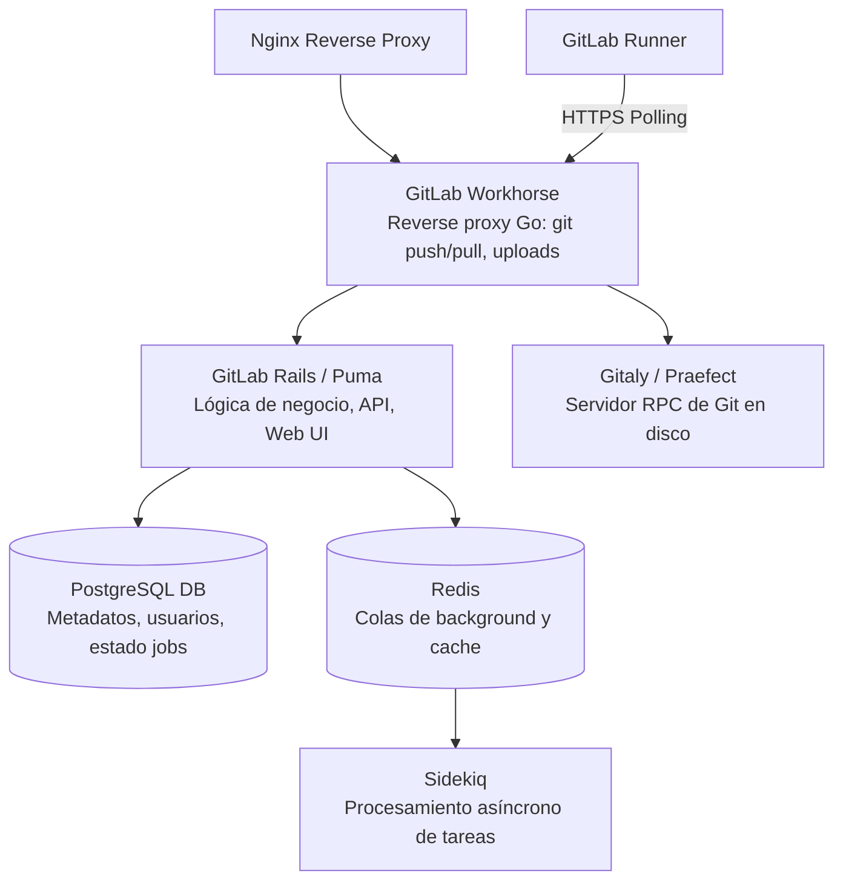
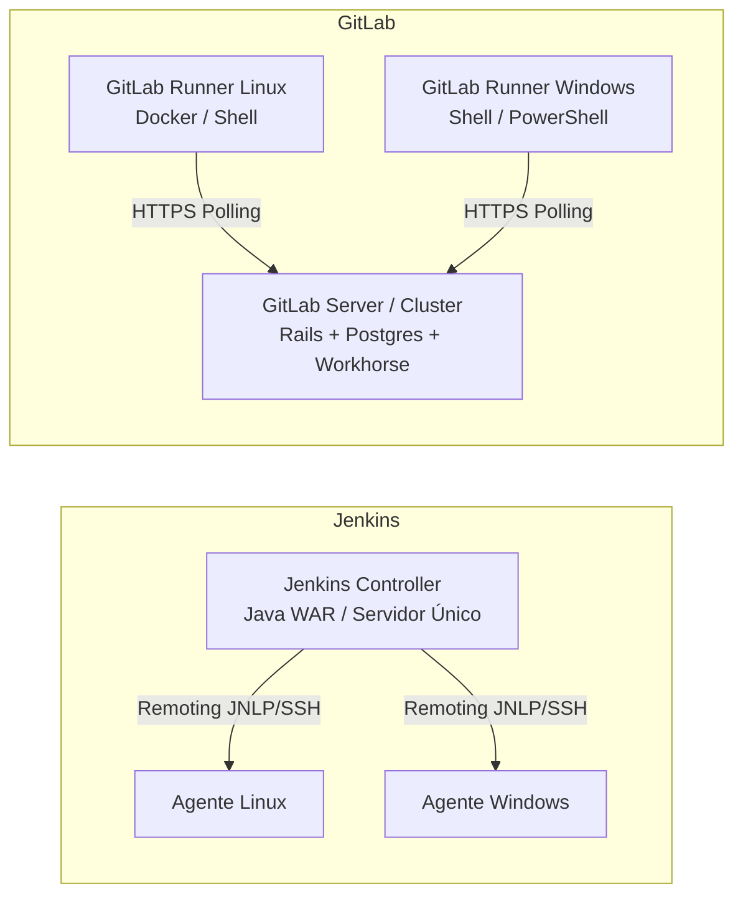

# GitLab Fundamentos

GitLab es una plataforma integral de **DevSecOps** que cubre todo el ciclo de vida del desarrollo de software en una única aplicación: gestión de código fuente (SCM), seguimiento de incidentes, CI/CD, registros de artefactos/paquetes y escaneos integrados de seguridad.

A diferencia de Jenkins, donde el servidor es un orquestador que delega en plugins y agentes externos, GitLab integra el repositorio de código, el motor de pipelines y la gobernanza en un único modelo de datos unificado.

---

## Modelo de Despliegue: SaaS vs Self-Managed

| Característica | GitLab SaaS (GitLab.com) | GitLab Self-Managed (Omnibus / K8s) | Jenkins Tradicional |
|---|---|---|---|
| **Mantenimiento Infra** | Gestionado por GitLab Inc. | Gestionado por el equipo interno | Gestionado internamente (Controller + Nodos) |
| **Runners / Agentes** | Compartidos (Linux/Windows) o propios | Runners propios registrados en tus redes/nodos | Nodos/Agentes conectados por JNLP, SSH o Cloud |
| **Almacenamiento Código** | En la nube pública de GitLab | En tus servidores (Gitaly / discos locales) | Bitbucket / GitHub / GitLab externo |
| **Upgrades y Parches** | Continuos y transparentes | Manuales (mensuales con ruta estricta) | Manuales (WAR + matriz de compatibilidad de plugins) |

---

## Jerarquía de Organización: Grupos, Subgrupos y Proyectos

En Jenkins, la organización habitual se realiza mediante carpetas anidadas (*Folders Plugin*) y configuraciones de seguridad por carpeta (*Role-based Authorization Strategy*).

En GitLab existe una jerarquía nativa:

```text
Grupo Raíz (ej: 'mi-organizacion')
├── Subgrupo ('backend')
│   ├── Proyecto ('api-auth')           <-- Repo + Issues + CI/CD + Registry
│   └── Proyecto ('billing-service')
├── Subgrupo ('infraestructura')
│   ├── Proyecto ('iac-terraform')
│   └── Proyecto ('ci-templates')       <-- Catálogo de componentes / Shared CI
└── Variables / Runners de Grupo        <-- Heredados automáticamente hacia abajo
```

### Herencia clave en GitLab:
1. **Variables de CI/CD:** Definidas en el Grupo Raíz están disponibles para todos los subgrupos y proyectos hijos.
2. **Runners de Grupo:** Un pool de runners configurado en el grupo puede ejecutar pipelines de cualquier proyecto hijo.
3. **Roles y Miembros:** Quien tiene permisos de `Developer` o `Maintainer` a nivel de grupo, hereda ese rol en todos los proyectos anidados.

---

## Roles y Matriz de Permisos

GitLab no maneja permisos atómicos por pantalla como Jenkins, sino roles estandarizados:

| Rol GitLab | Equivalente aproximado Jenkins / Bitbucket | Capacidades Clave |
|---|---|---|
| **Guest** | Lectura limitada | Ver issues públicos/privados asignados. Sin acceso al código. |
| **Reporter** | Reader / Auditor | Clonar repositorio, descargar artefactos, ver logs de CI. |
| **Developer** | Builder / Dev estándar | Crear ramas, abrir Merge Requests, disparar pipelines, publicar artefactos. |
| **Maintainer** | Job Admin / Tech Lead | Crear tags, proteger ramas y variables, registrar runners de proyecto, mergear a ramas protegidas. |
| **Owner** | Jenkins Administrator | Eliminar proyecto/grupo, transferir propiedad, gestionar facturación y membresía total. |

---

## Arquitectura Interna de GitLab

Si operás o interactuás con una instancia Self-Managed, estos son los servicios centrales:



### Componentes principales:
- **GitLab Rails (Puma):** El núcleo de la aplicación web y la API REST/GraphQL.
- **GitLab Workhorse:** Proxy inverso ligero en Go que maneja tráfico pesado (uploads de artefactos grandes, git over HTTP, downloads).
- **Gitaly:** Servicio RPC dedicado al acceso a repositorios Git en almacenamiento de alta velocidad.
- **Sidekiq:** Motor de tareas en segundo plano que procesa webhooks, envíos de mails y disparos de pipelines.
- **GitLab Runner:** Agente autónomo que consulta la API de GitLab mediante polling sobre HTTPS (sin necesidad de abrir puertos de entrada hacia el runner).

---

## Comparativa con la Arquitectura de Jenkins



### Diferencias operativas fundamentales:
- **Sin conexión entrante a los agentes:** En Jenkins, el controller con frecuencia debe poder alcanzar a los agentes vía SSH o mantener túneles JNLP dedicados. En GitLab, **todos los runners inician la comunicación por HTTPS saliente** hacia la URL de GitLab.
- **Sin estado en el servidor CI:** Jenkins guarda el historial de builds en disco (`JENKINS_HOME/jobs/.../builds`). GitLab almacena el estado y metadatos en PostgreSQL y los artefactos y logs en Object Storage (S3 / MinIO) o disco local.

---

## Relacionado

- [/article/gitlab/02-jenkins-vs-gitlab/](/article/gitlab/02-jenkins-vs-gitlab/) — Matriz completa de equivalencias Jenkins $\leftrightarrow$ GitLab.
- [/article/gitlab/03-gitlab-ci-yml-basico/](/article/gitlab/03-gitlab-ci-yml-basico/) — Anatomía del archivo de pipeline `.gitlab-ci.yml`.
- [/article/gitlab/06-runners/](/article/gitlab/06-runners/) — Instalación, configuración de executors y registro de GitLab Runners.
- [/article/jenkins/01-fundamentos/](/article/jenkins/01-fundamentos/) — Fundamentos de Jenkins para comparar topologías.
