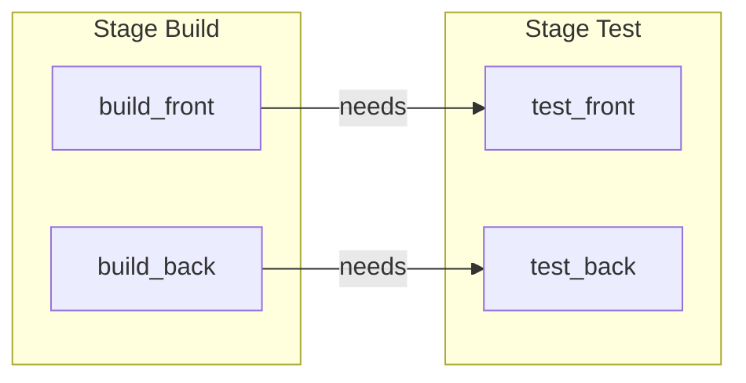

# Rules, Workflow y Needs: Flujo y Pipelines DAG

En GitLab moderno, las antiguas palabras clave `only` y `except` se consideran **legacy**. El estándar absoluto para controlar cuándo, cómo y bajo qué condiciones corre un job es **`rules`**.

Adicionalmente, el uso de **`needs`** transforma un pipeline secuencial clásico en un **Grafo Acíclico Dirigido (DAG)**, permitiendo que jobs de stages avanzados arranquen sin esperar a que termine todo el stage anterior.

---

## Control de Jobs con `rules`

El bloque `rules` evalúa una lista de condiciones en orden secuencial. La primera condición que resulta verdadera determina el comportamiento del job:

```yaml
test_unitario:
  stage: test
  script:
    - npm test
  rules:
    # 1. No ejecutar en commits cuyo mensaje contenga [skip ci]
    - if: '$CI_COMMIT_MESSAGE =~ /\[skip ci\]/'
      when: never

    # 2. Si cambiaron archivos en src/ o package.json, ejecutar siempre
    - changes:
        - src/**/*
        - package.json
      when: on_success

    # 3. En la rama main, ejecutar siempre
    - if: '$CI_COMMIT_BRANCH == "main"'
      when: on_success

    # 4. En cualquier otro caso, no ejecutar
    - when: never
```

### Operadores y Cláusulas Comunes en `rules`
- `if`: Evalúa variables de entorno estándar (`$CI_COMMIT_BRANCH`, `$CI_PIPELINE_SOURCE`, etc.). Admite comparadores de igualdad (`==`, `!=`) y expresiones regulares (`=~`, `!~`).
- `changes`: Evalúa si se modificaron archivos o patrones específicos en el commit o Merge Request.
- `exists`: Verifica si existen archivos específicos en el repositorio (ej: `exists: [ Dockerfile ]`).
- `when`:
  - `on_success`: (Default) Ejecuta si los jobs previos tuvieron éxito.
  - `manual`: Convierte el job en un botón manual (ideal para despliegues a producción).
  - `delayed`: Pospone la ejecución durante un tiempo (ej: `start_in: '15 minutes'`).
  - `never`: Descarta el job del pipeline.

---

## Evitar Pipelines Duplicados con `workflow:rules`

Un problema clásico al abrir un Merge Request es la aparición de **pipelines duplicados**: uno para el push a la rama (`branch pipeline`) y otro para el Merge Request (`merge_request_event`).

Para solucionar esto a nivel global de todo el repositorio, se usa `workflow:rules`:

```yaml
workflow:
  rules:
    # Si es un Merge Request, generar pipeline de MR
    - if: '$CI_PIPELINE_SOURCE == "merge_request_event"'
    # Si es push a rama pero ya tiene un MR abierto, no duplicar
    - if: '$CI_COMMIT_BRANCH && $CI_OPEN_MERGE_REQUESTS'
      when: never
    # Si es push a ramas principales o tags sin MR
    - if: '$CI_COMMIT_BRANCH'
    - if: '$CI_COMMIT_TAG'
```

---

## Aceleración con `needs` (Pipelines DAG)

Por defecto, los pipelines en GitLab son estrictamente por etapas: ningún job del stage `test` arranca hasta que **todos** los jobs del stage `build` hayan terminado.

Con `needs`, un job puede comenzar apenas sus dependencias directas finalicen, ignorando el estado del resto del stage anterior:



```yaml
build_front:
  stage: build
  script: npm run build:front

build_back:
  stage: build
  script: npm run build:back

test_front:
  stage: test
  needs: ["build_front"]
  script: npm run test:front

test_back:
  stage: test
  needs: ["build_back"]
  script: npm run test:back
```

> **Truco:** Si un job no necesita ningún artefacto ni esperar a nada del stage anterior, podés configurarle `needs: []`. Esto hará que arranque en el segundo `0` apenas se dispare el pipeline.

---

## Si Venís de Jenkins

| En Jenkins | En GitLab |
|---|---|
| `when { branch 'main' }` | `rules: [ if: '$CI_COMMIT_BRANCH == "main"' ]` |
| `when { changeset "src/**" }` | `rules: [ changes: [ "src/**" ] ]` |
| `when { expression { params.DEPLOY == true } }` | `rules: [ if: '$DEPLOY == "true"' ]` |
| `input message: 'Aprobar?'` | `rules: [ when: manual ]` |

---

## Relacionado

- [/article/gitlab/03-gitlab-ci-yml-basico/](/article/gitlab/03-gitlab-ci-yml-basico/) — Estructura básica de `.gitlab-ci.yml`.
- [/article/gitlab/05-variables-y-secretos/](/article/gitlab/05-variables-y-secretos/) — Manejo de variables para condiciones de rules.
- [/article/gitlab/09-pipelines-avanzados/](/article/gitlab/09-pipelines-avanzados/) — Pipelines parent-child y multi-proyecto.
