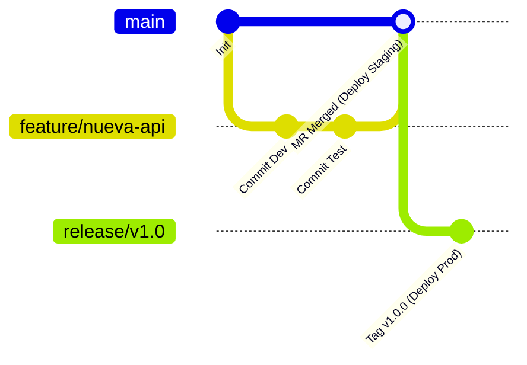

# Merge Requests y Flujo Git en GitLab

El **Merge Request (MR)** es el eje central de colaboración, control de calidad y auditoría en GitLab. A diferencia de Bitbucket o GitHub donde el CI suele ser un chequeo externo reportado vía webhook, en GitLab el ciclo de vida del MR está profundamente acoplado al motor de pipelines.

---

## Flujo de Trabajo y Políticas de Protección

### Ramas Protegidas (`Protected Branches`)
En **Settings > Repository > Protected Branches**, definís quién tiene privilegios sobre ramas críticas como `main` o `release/*`:
- **Allowed to push:** Configurar en `No one` (obliga a que todo cambio pase indefectiblemente por un Merge Request revisado).
- **Allowed to merge:** Restringido a roles `Maintainers` o grupos específicos de aprobación.
- **Force push:** Debe estar estrictamente desactivado.

---

## Reglas de Calidad y Merge Checks

En **Settings > Merge requests**, se pueden configurar las siguientes salvaguardas:

1. **Pipelines must succeed:** Impide que el botón de *Merge* se habilite si el pipeline asociado al último commit está fallido o en ejecución.
2. **All discussions must be resolved:** Obliga a que todos los comentarios o revisiones en el código hayan sido resueltos por el autor o los revisores.
3. **Squash commits when merging:** Unifica todos los commits parciales de la rama de trabajo en un único commit limpio en la rama principal.

---

## Archivo `CODEOWNERS`

Podés definir responsabilidades automáticas de revisión según las rutas modificadas colocando un archivo `CODEOWNERS` en `.gitlab/` o en la raíz:

```text
# Arquitectura y configuración de pipelines requiere revisión obligatoria de DevOps
.gitlab-ci.yml        @alan-devops
/ci-templates/        @alan-devops @infra-team

# Base de datos requiere revisión del equipo DBA
/migrations/          @dba-team
*.sql                 @dba-team

# Regla global por defecto para el resto del código
*                     @tech-leads
```

Cuando un desarrollador abre un MR tocando scripts de CI o migraciones de base de datos, GitLab asigna automáticamente a los miembros correspondientes como aprobadores necesarios.

---

## GitLab Flow vs GitFlow Clásico

Para equipos modernos de DevOps, GitLab recomienda simplificar las complejidades de GitFlow:



- **Ramas cortas de feature:** Se desprenden de `main` y se integran rápido mediante MRs pequeños.
- **Ramas de entorno (`main` $
ightarrow$ `staging`, `production`):** El paso entre ambientes se gestiona mediante merges controlados o mediante tags Git versionados semánticamente (`v1.2.0`).

---

## Si Venís de Bitbucket y Jenkins

| En Bitbucket / Jenkins | En GitLab |
|---|---|
| Pull Request en Bitbucket dispara Webhook a Jenkins | Merge Request nativo dispara pipeline de evento `merge_request_event`. |
| Estado del build reportado como Commit Status vía API | Integración nativa sin tokens ni plugins externos. |
| Aprobaciones de PR configuradas en Bitbucket | Approval Rules nativas y vinculadas a `CODEOWNERS`. |

---

## Relacionado

- [/article/gitlab/04-rules-workflow-y-needs/](/article/gitlab/04-rules-workflow-y-needs/) — Configurar pipelines específicos para eventos de Merge Request.
- [/article/gitlab/10-environments-y-deploys/](/article/gitlab/10-environments-y-deploys/) — Despliegue de Review Apps vinculadas a MRs.
- [/article/git/02-ramas-y-fusion/](/article/git/02-ramas-y-fusion/) — Conceptos y estrategias de fusión en Git.
