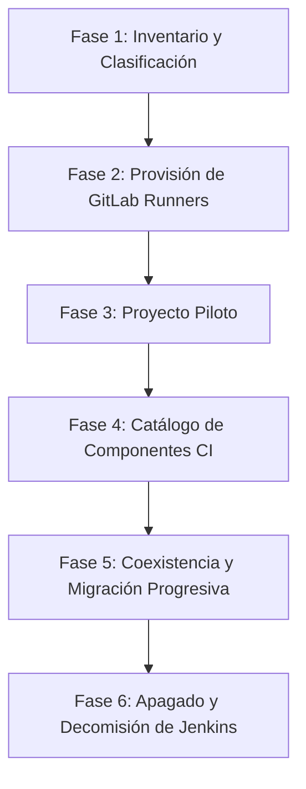

# Plan de Migración de Jenkins a GitLab CI: Guía de Transición

Migrar una infraestructura corporativa desde Jenkins hacia GitLab CI no debe hacerse de golpe. Requiere una estrategia por fases para asegurar que los despliegues a producción no se interrumpan y que el equipo adopte el nuevo modelo mental sin fricciones.

---

## Fases del Plan de Migración



### Fase 1: Inventario y Dependencias
1. Listar todos los jobs de Jenkins clasificándolos por complejidad:
   - **Simples:** Builds estándar Node, Java o Docker disparados por webhook.
   - **Orquestadores:** Pipelines scripted que llaman múltiples `build job:` con parámetros.
   - **Especiales:** Tareas programadas en cron o con dependencias nativas en nodos Windows.
2. Identificar el uso de la Shared Library `@Library('devops')`: relevar qué funciones (`vars/*.groovy`) son indispensables.

### Fase 2: Infraestructura de GitLab Runners
Antes de escribir el primer pipeline, asegurate de tener la infraestructura de ejecución lista:
- Registrar un pool de **Runners Docker en Linux** para las compilaciones estándar.
- Registrar **Runners en Windows** (con tags `windows`, `powershell`) si tenés compilaciones .NET Framework o tareas en IIS.

### Fase 3: Proyecto Piloto
Seleccioná una aplicación de criticidad media que tenga buena cobertura de tests.
- Replicá el `Jenkinsfile` en `.gitlab-ci.yml`.
- Validá tiempos de compilación, descarga de artefactos y despliegues automáticos a ambientes de prueba (`staging`).

### Fase 4: Reemplazo de Shared Library por Componentes
Traducí las funciones centrales de la librería Groovy a **CI/CD Components** reutilizables (ver [/article/gitlab/08-include-extends-y-components/](/article/gitlab/08-include-extends-y-components/)).

### Fase 5: Coexistencia Temporal
Durante la transición, es habitual que GitLab y Jenkins convivan:
- **GitLab dispara a Jenkins:** Mediante la integración oficial de Jenkins en GitLab (**Settings > Integrations > Jenkins**) o webhooks para proyectos que aún no fueron migrados.
- **Jenkins notifica a GitLab:** El plugin de GitLab para Jenkins reporta el commit status a los Merge Requests mientras se termina la migración.

---

## Ejemplo Práctico: Traducción de Casos Frecuentes

### Caso 1: Build + SonarQube + Publicación de Artefactos

#### En Jenkins (`Jenkinsfile` Declarativo):
```groovy
pipeline {
    agent { label 'COMPILER_LINUX' }
    stages {
        stage('Build & Test') {
            steps {
                sh 'npm ci && npm test'
            }
        }
        stage('Sonar') {
            steps {
                withSonarQubeEnv('SonarQube') {
                    sh 'sonar-scanner'
                }
            }
        }
    }
}
```

#### En GitLab CI (`.gitlab-ci.yml`):
```yaml
stages:
  - build_and_test
  - analysis

build_and_test:
  stage: build_and_test
  image: node:20-alpine
  script:
    - npm ci
    - npm test

sonar_scan:
  stage: analysis
  image: sonarsource/sonar-scanner-cli:latest
  script:
    - sonar-scanner -Dsonar.qualitygate.wait=true
```

---

## Errores y Antipatrones Comunes al Migrar

1. **Querer programar lógica compleja en el YAML:** No intentes recrear algoritmos Groovy en el archivo de CI. Si requerís lógica condicional pesada, escribí un script Bash/Python en el repositorio e invocalo desde el `script:`.
2. **Crear un único `.gitlab-ci.yml` gigantesco:** Modularizá usando `include: local` o componentes compartidos.
3. **Runners privilegiados para todo:** Evitá configurar `privileged = true` en todos los runners; reservalo exclusivamente para jobs de Docker-in-Docker que lo necesiten.

---

## Relacionado

- [/article/gitlab/02-jenkins-vs-gitlab/](/article/gitlab/02-jenkins-vs-gitlab/) — Tabla maestra de equivalencias Jenkins vs GitLab.
- [/article/gitlab/08-include-extends-y-components/](/article/gitlab/08-include-extends-y-components/) — Migración de Shared Libraries a Components.
- [/article/jenkins/07-orquestacion-de-despliegues/](/article/jenkins/07-orquestacion-de-despliegues/) — Patrones de orquestación en Jenkins.
