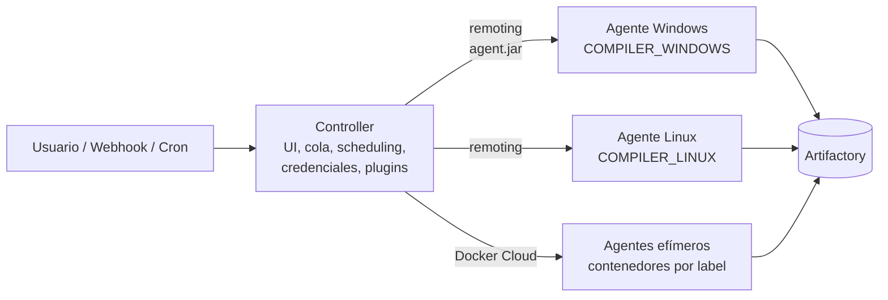

# Jenkins Fundamentos

## ¿Qué es Jenkins?

Jenkins es un servidor de automatización open source escrito en Java. Ejecuta **jobs** (builds, deploys, tareas programadas) disparados manualmente, por webhook, por cron o por otro job. La lógica moderna se escribe como **Pipeline as Code**: un `Jenkinsfile` en Groovy versionado en Git.

---

## Arquitectura: controller y agentes



| Componente | Responsabilidad |
|-----------|-----------------|
| **Controller** (ex "master") | UI, cola de builds, scheduling, almacena config, credenciales y plugins. Idealmente **no** compila. |
| **Agente** (ex "slave") | Ejecuta los pasos del pipeline (`sh`, `bat`, `powershell`). Se conecta al controller vía `agent.jar` (remoting). |
| **Executor** | Slot de ejecución dentro de un agente. Un agente con 2 executors corre 2 builds en paralelo. |
| **Label** | Etiqueta que agrupa agentes por capacidad (`COMPILER_WINDOWS`, `COMPILER_LINUX`, `SONAR_DOCKER`). El pipeline pide un label, no una máquina. |
| **Cloud** | Proveedor de agentes efímeros (Docker, Kubernetes, EC2). Levanta un agente cuando hay builds en cola para su label y lo destruye al terminar. |

> Regla práctica: el controller orquesta, los agentes trabajan. Poner `numExecutors = 0` en el controller evita que un build pesado deje sin recursos a la UI y la cola.

---

## Tipos de jobs

| Tipo | Uso |
|------|-----|
| **Pipeline** | Un `Jenkinsfile` (inline o desde SCM). El tipo estándar. |
| **Multibranch Pipeline** | Crea un job por cada rama/PR que tenga `Jenkinsfile`. |
| **Folder** | Agrupa jobs; puede tener credenciales y variables propias. Ej.: `PLS/Backoffice-BE/deploy-bowas`. |
| **Freestyle** | Configuración por UI. Legacy, evitar para lógica nueva. |

Los jobs se referencian por ruta completa desde otros pipelines:

```groovy
build job: '/PLS/Backoffice-BE/deploy-bowas', parameters: [string(name: 'ENVIRONMENT', value: 'qa')]
```

---

## Estructura de JENKINS_HOME

Ubicación típica: `/var/lib/jenkins` (paquete del SO) o `/var/jenkins_home` (imagen Docker oficial).

```text
JENKINS_HOME/
├── config.xml                 # Config global (seguridad, clouds, vistas)
├── credentials.xml            # Credenciales cifradas
├── secrets/                   # Claves maestras para descifrar credentials.xml (¡crítico!)
├── plugins/                   # .jpi/.hpi instalados
├── nodes/<NODO>/config.xml    # Definición de cada agente estático
├── users/                     # Usuarios locales y sus API tokens
├── *.xml                      # Config de cada plugin (ej. org.jfrog...ArtifactoryBuilder.xml)
├── jobs/<folder>/jobs/<job>/
│   ├── config.xml             # Definición del job
│   └── builds/<N>/            # Historial: build.xml, log, artefactos archivados
├── workspace/                 # Workspaces de builds que corrieron en el controller
├── init.groovy.d/             # Scripts Groovy que corren en cada arranque
└── queue.xml                  # Cola persistida al apagar
```

> `credentials.xml` sin el directorio `secrets/` correspondiente es inútil: las credenciales no se pueden descifrar. Siempre se respaldan juntos.

---

## Pipeline as Code

El modelo recomendado separa tres capas:

| Capa | Dónde vive | Contenido |
|------|-----------|-----------|
| **Jenkinsfile** | Repo de orquestación (`lotteries/Backend/build-core.jenkinsfile`) | Orquestación liviana: stages, nodos, llamadas a la librería |
| **Shared Library** | `vars/` y `src/` del mismo repo | Lógica reutilizable (`jfrog`, `vault`, `iis`, `notification`) |
| **Configuración** | `resources/` | JSONs de entornos, rutas de apps, specs de Artifactory, templates |

```groovy
@Library('devops')_            // carga la shared library configurada en Jenkins

node('COMPILER_LINUX') {
    stage('Checkout') { checkout scm }
    stage('Build')    { sh 'make build' }
}
```

Ver [Pipelines declarativos vs scripted](/article/jenkins/02-pipelines-declarativos-y-scripted/) y [Shared Libraries](/article/jenkins/03-shared-libraries/).

---

## Convenciones de naming

| Elemento | Convención | Ejemplo |
|----------|-----------|---------|
| Pipelines | `verbo-objeto.jenkinsfile` | `build-core.jenkinsfile`, `deploy-ui.jenkinsfile` |
| Parámetros / env vars | `UPPER_SNAKE_CASE` | `BRANCH_NAME`, `ENVIRONMENT` |
| Variables Groovy | `camelCase` | `appData`, `deployResults` |
| Funciones globales (`vars/`) | `camelCase` descriptivo | `getAppPaths`, `cleanWorkspace` |
| Labels de agentes | `UPPER_SNAKE_CASE` por capacidad | `COMPILER_WINDOWS`, `COMPILER_LINUX_NET10` |

---

## Comandos y URLs útiles

```bash
# Versión y estado
curl -s -o /dev/null -w "%{http_code}\n" http://jenkins:8080/login

# Descargar el agent.jar que corresponde a ESTE controller (versión de remoting exacta)
curl -O http://jenkins:8080/jnlpJars/agent.jar

# CLI de Jenkins
curl -O http://jenkins:8080/jnlpJars/jenkins-cli.jar
java -jar jenkins-cli.jar -s http://jenkins:8080/ -auth user:API_TOKEN list-jobs
java -jar jenkins-cli.jar -s http://jenkins:8080/ -auth user:API_TOKEN safe-restart
```

| URL | Para qué |
|-----|----------|
| `/manage` | Administración |
| `/script` | Script Console (Groovy con privilegios de sistema) |
| `/safeRestart` | Reinicia cuando terminan los builds en curso |
| `/quietDown` | Deja de aceptar builds nuevos (previo a mantenimiento) |
| `/computer/` | Estado de agentes |
| `/job/<j>/<N>/consoleText` | Log plano de un build |
