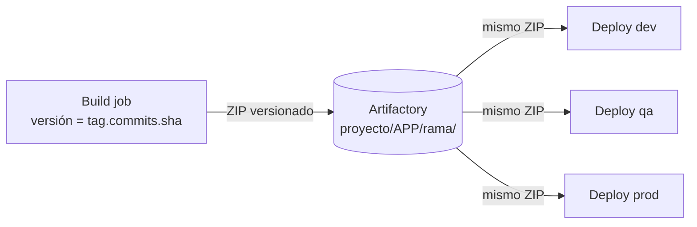

# Build Once, Deploy Many: Artifactory y SonarQube

## El patrón



- El **build** genera un artefacto inmutable con versión y commit en el nombre (`Core_4.12.37.a1b2c3d4.zip`).
- Los **deploys** nunca compilan: descargan ese mismo binario. Lo que llega a producción es exactamente lo que se probó en QA.
- La configuración por entorno se aplica en el deploy (reemplazo de `appsettings`, `Web.config`), no en el build.

---

## Servidor Artifactory en el pipeline

Con el plugin *Artifactory* (JFrog), el servidor se configura en **Manage Jenkins → System** con un ID:

```groovy
def server = Artifactory.server 'artifactory-main'
```

### Upload spec como template en `resources/`

```json
{
  "files": [{
    "pattern": "{ZIP_PATH}",
    "target": "myproject/{APP}/{BRANCH}/",
    "props": "version={VERSION};commit={COMMIT};fullCommit={FCOMMIT}"
  }]
}
```

```groovy
def uploadArtifacts(Map config = [:]) {
    def server = Artifactory.server 'artifactory-main'
    def spec = config.uploadSpecTemplate
        .replace('{ZIP_PATH}', config.packageZipfile)
        .replace('{APP}',      config.appName.toUpperCase())
        .replace('{BRANCH}',   config.branchName)
        .replace('{VERSION}',  config.buildInfo.appVersion)
        .replace('{COMMIT}',   config.buildInfo.commitId)
        .replace('{FCOMMIT}',  config.buildInfo.fullcommitId)

    def buildInfo = server.upload spec: spec
    server.publishBuildInfo buildInfo
}
```

### Download con reintentos

Útil cuando el deploy se dispara apenas termina el build y el artefacto puede tardar en indexarse:

```groovy
def downloadArtifact(Map spec) {
    def server = Artifactory.server 'artifactory-main'
    def downloadSpec = """{
      "files": [{ "pattern": "${spec.pattern}", "target": "${spec.target}/", "recursive": "false", "flat": "true" }]
    }"""

    int maxRetries = 10                       // 10 x 30s = 5 minutos
    for (int i = 0; i < maxRetries; i++) {
        server.download spec: downloadSpec
        if (findFiles(glob: "${spec.target}/*.zip").length > 0) return
        echo "Artefacto no disponible aún, reintento ${i + 1}/${maxRetries}"
        sleep time: 30, unit: 'SECONDS'
    }
    error "No se encontró ${spec.pattern} en Artifactory"
}
```

### No recompilar si el paquete ya existe

```groovy
def checkPackageExists(Map c) {
    def fileName   = c.packageZipfile.tokenize('/\\').last()
    def searchPath = "${c.project}/${c.appName.toUpperCase()}/${c.branchName}/${fileName}"
    def tempDir    = "tmp_pkg_check_${System.currentTimeMillis()}"
    try {
        Artifactory.server('artifactory-main').download spec: """{"files":[{"pattern":"${searchPath}","target":"${tempDir}/","flat":"true"}]}"""
        return findFiles(glob: "${tempDir}/*.zip").length > 0
    } catch (Exception e) {
        echo "No se pudo verificar (${e.message}); se compila igual."
        return false                           // ante la duda, compilar
    } finally {
        dir(tempDir) { deleteDir() }
    }
}
```

```groovy
stage('Check Existing Package') {
    if (!params.FORCE_BUILD?.toBoolean() && checkPackageExists(...)) {
        currentBuild.description = "${appVersion} [already exists]"
        skipBuild = true
    }
}
```

> Como la versión incluye el SHA del commit, "ya existe" significa "este mismo código ya fue compilado". Un parámetro `FORCE_BUILD` permite saltear el chequeo.

> **Ojo:** el upload/download lo ejecuta el **agente**, no el controller. La URL de Artifactory tiene que ser alcanzable desde los nodos de build (importante al mover Jenkins de red, p. ej. en un DRP).

---

## SonarQube: Quality Gate sin alargar el build

Requisitos:
1. Plugin *SonarQube Scanner* con el servidor configurado (nombre `SonarQube`).
2. En SonarQube, un **webhook** a `https://jenkins/sonarqube-webhook/` — `waitForQualityGate` espera ese callback.

### Componente reutilizable

```groovy
// vars/sonarGate.groovy
def call(Map config = [:]) {
    def runScan = { withSonarQubeEnv(config.sonarEnv ?: 'SonarQube') { config.scan.call() } }

    if (config.credentialsId) {
        withCredentials([string(credentialsId: config.credentialsId, variable: 'SONAR_TOKEN')]) { runScan() }
    } else {
        runScan()
    }

    def gate
    timeout(time: config.gateTimeoutMinutes ?: 10, unit: 'MINUTES') {
        gate = waitForQualityGate()
    }
    def ok = gate.status == 'OK'
    if (!ok && config.failBuildOnGate) error "Quality Gate failed: ${gate.status}"
    return [status: gate.status, ok: ok]
}
```

El caller provee el scan, así el mismo componente sirve para Node y .NET:

```groovy
// Node / Angular
def gate = sonarGate(scan: { sh 'sonar-scanner -Dsonar.projectKey=ui-backoffice' })

// .NET (begin → build → tests → end)
def gate = sonarGate(scan: {
    bat 'dotnet sonarscanner begin /k:"core" /d:sonar.cs.opencover.reportsPaths="**/coverage.opencover.xml"'
    bat 'dotnet build -c Release'
    bat 'dotnet test --collect:"XPlat Code Coverage" -- DataCollectionRunSettings.DataCollectors.DataCollector.Configuration.Format=opencover'
    bat 'dotnet sonarscanner end'
})
```

### Análisis en paralelo con el packaging

```groovy
def gateResult = [status: 'SKIPPED', ok: true]
parallel(
    Package: { stage('Package') { zip zipFile: packageZipfile, dir: 'publish' } },
    Sonar:   { stage('Sonar')   { gateResult = sonarGate(scan: { sh 'sonar-scanner' }) } }
)
```

### No publicar si el gate falla

```groovy
def blocksUpload(Map gateResult, String appVersion, String packageName) {
    def unstable = currentBuild.result == 'UNSTABLE'
    if (gateResult.ok && !unstable) return false

    def reason = gateResult.ok ? 'build UNSTABLE' : "Quality Gate ${gateResult.status}"
    currentBuild.result = 'UNSTABLE'
    currentBuild.description = "${appVersion} [Sonar: ${reason} - no se subió a Artifactory]"
    echo "No se sube '${packageName}' a Artifactory (${reason})."
    return true
}

stage('Upload') {
    if (runSonar && sonarGate.blocksUpload(gateResult, appVersion, packageZipfile)) return
    jfrog.uploadArtifacts(...)
}
```

| Situación | Resultado |
|-----------|-----------|
| Sonar deshabilitado | Upload normal |
| Gate OK y tests OK | Upload normal |
| Gate ERROR | Build UNSTABLE, sin upload, motivo en la descripción |
| Tests fallidos / sin coverage (UNSTABLE) | Build UNSTABLE, sin upload |
| `waitForQualityGate` timeout | Revisar webhook de SonarQube → Jenkins |
