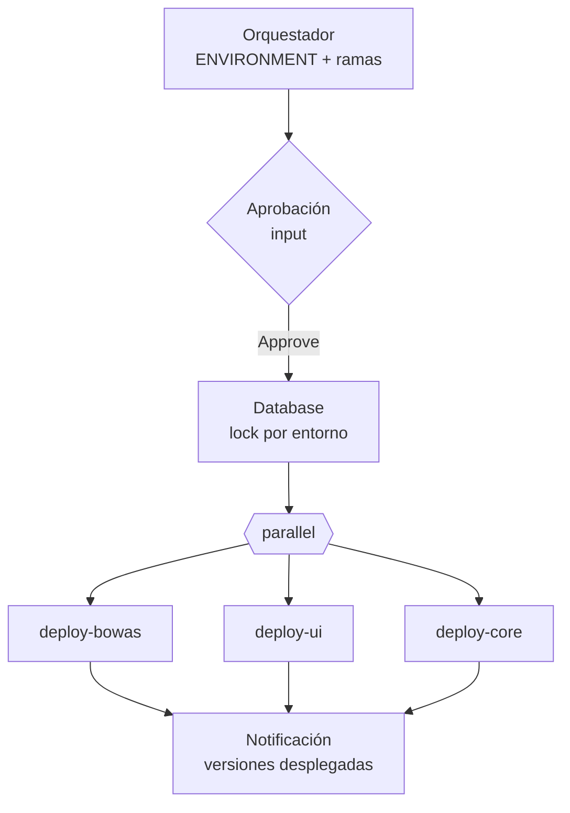

# Orquestación de Despliegues

## Arquitectura



- Cada componente tiene su **job de deploy** independiente, ejecutable a mano.
- El **orquestador** decide qué desplegar, en qué orden, y agrega resultados.
- La base de datos va primero y bajo `lock`; las aplicaciones en paralelo.

---

## Disparar jobs downstream

```groovy
def result = build job: '/PLS/Backoffice-BE/deploy-bowas',
    wait: true,                   // default: espera y falla si el downstream falla
    propagate: true,
    parameters: [
        string(name: 'BRANCH_NAME', value: params.BACKEND_BRANCH),
        string(name: 'ENVIRONMENT', value: envName),
        string(name: 'REQUIRED_APPROVAL_NEXT', value: 'false'),
        booleanParam(name: 'GENERATE_BACKUP', value: params.GENERATE_DATABASE_BACKUP.toBoolean())
    ]

echo "Resultado: ${result.result} - ${result.absoluteUrl}"
```

| Opción | Efecto |
|--------|--------|
| `wait: false` | Dispara y sigue (fire-and-forget) |
| `propagate: false` | No falla el orquestador si el downstream falla; revisar `result.result` |
| `quietPeriod: 0` | Arranca sin esperar el quiet period |

---

## Devolver datos desde el job hijo

El hijo setea variables de entorno; el padre las lee con `getBuildVariables()`:

```groovy
// Job hijo (deploy)
env.DEPLOYMENT_SUMMARY    = "core ${appVersion} → ${params.ENVIRONMENT}"
env.DEPLOYED_VERSION_JSON = groovy.json.JsonOutput.toJson([app: 'core', version: appVersion, env: params.ENVIRONMENT])
```

```groovy
// Orquestador
def r = build job: '/PLS/deploy-core', parameters: [...]
echo r.getBuildVariables().get('DEPLOYMENT_SUMMARY')

def json = r.getBuildVariables().get('DEPLOYED_VERSION_JSON')
if (json) deployResults << readJSON(text: json)
```

---

## Flags para saber "quién me llamó"

Los jobs hijos aceptan parámetros que **solo** pasa el orquestador. Si vienen `null`, el job fue lanzado a mano:

```groovy
// ¿Pedir aprobación? Si me llama el orquestador (que ya aprobó), no.
Boolean checkRequireApproval(Boolean isOrchestrator = false) {
    Boolean result = env.DEPLOY_REQUIRED_APPROVAL.toBoolean()        // variable global de Jenkins
    if (result && !isOrchestrator) {
        result = params.REQUIRED_APPROVAL_NEXT == null
    }
    return result
}

// ¿Arrancar el servicio al final? El orquestador puede diferirlo para arrancar todo junto.
Boolean checkStartServiceAfterDeploy() {
    return params.START_SERVICE_AFTER_DEPLOY == null ? true :
           params.START_SERVICE_AFTER_DEPLOY.toString().toLowerCase() != 'false'
}
```

---

## Aprobaciones con `input`

```groovy
def approve(List<String> approvers, int timeoutMinutes = 45) {
    def answer
    timeout(time: timeoutMinutes, unit: 'MINUTES') {
        answer = input(
            id: 'wait-approval',
            message: 'Waiting for approval',
            submitter: approvers.join(','),          // usuarios o grupos autorizados
            submitterParameter: 'submitter',         // devuelve quién aprobó
            parameters: [
                choice(name: 'choice', choices: ['Reject', 'Approve'], description: 'Are you sure?'),
                text(name: 'comment', defaultValue: '', description: 'Comentario')
            ])
    }
    if (answer.choice != 'Approve') {
        def cause = new jenkins.model.CauseOfInterruption.UserInterruption("Rechazado por ${answer.submitter}")
        throw new org.jenkinsci.plugins.workflow.steps.FlowInterruptedException(hudson.model.Result.ABORTED, cause)
    }
    return answer.submitter
}
```

Distinguir el motivo de la interrupción:

```groovy
catch (org.jenkinsci.plugins.workflow.steps.FlowInterruptedException ex) {
    def causes = ex.causes*.toString()
    if (causes.any { it.contains('Rejection') })        echo 'Rechazado desde la UI (Abort)'
    else if (causes.any { it.contains('ExceededTimeout') }) echo 'Timeout de aprobación'
    else if (causes.any { it.contains('UserInterruption') }) echo 'El aprobador eligió Reject'
    throw ex
}
```

> **No** pedir `input` dentro de un `node {}`: el build retiene el executor (y el agente) mientras espera horas una aprobación. Aprobar primero, después tomar el nodo.

Antes del `input` conviene notificar a los aprobadores (mail/Teams) con el link `${env.BUILD_URL}input/`.

---

## Locks sobre recursos compartidos

Plugin *Lockable Resources*. Evita dos deploys de base de datos simultáneos sobre el mismo entorno:

```groovy
lock(resource: "db-${envName}", inversePrecedence: true) {
    build job: '/PLS/Oracle/database-incremental', parameters: [...]
}
```

- `inversePrecedence: true`: el último en pedir el lock es el primero en obtenerlo (útil si el más nuevo invalida al anterior).
- `lock(label: 'qa-envs', quantity: 1)`: tomar uno cualquiera de un pool.

---

## Stages genéricos por componente

En vez de repetir 10 bloques casi idénticos, describir los componentes como datos:

```groovy
def components = [
    [componentName: 'BOWAS', stageName: '🚀 BOWAS', jobPath: '/PLS/deploy-bowas', branch: params.BACKEND_BRANCH],
    [componentName: 'APPC',  stageName: '🚀 APPC',  jobPath: '/PLS/deploy-appc',  branch: params.APPC_UI_BRANCH],
]

def deployAppComponent(Map o) {
    stage(o.stageName) {
        catchError(buildResult: 'FAILURE', stageResult: 'FAILURE') {
            if (!o.branch?.trim()) {
                echo "${o.componentName} no requiere actualización."
                o.resultMap[o.componentName] = false
                return
            }
            try {
                def r = build job: o.jobPath, parameters: [
                    string(name: 'BRANCH_NAME', value: o.branch),
                    string(name: 'ENVIRONMENT', value: o.environment),
                    string(name: 'REQUIRED_APPROVAL_NEXT', value: 'false')]
                o.resultMap[o.componentName] = true
            } catch (Exception ex) {
                // 'failed' ≠ false: el deploy pudo haber detenido el servicio antes de fallar
                o.resultMap[o.componentName] = 'failed'
                throw ex
            }
        }
    }
}

def resultMap = [:]
parallel components.collectEntries { c ->
    [(c.componentName): { deployAppComponent(c + [environment: params.ENVIRONMENT, resultMap: resultMap]) }]
}
```

---

## Autodeploy por cambio de commit (pipeline con estado)

Job declarativo con `cron('H * * * *')` que despliega solo si cambió el HEAD de alguna rama. El estado se guarda en las variables del **último build exitoso**:

```groovy
def previous = currentBuild.previousSuccessfulBuild?.buildVariables ?: [:]
def changed = []

repos.each { r ->
    def head = sh(returnStdout: true,
                  script: "git ls-remote ${r.url} refs/heads/${r.branch} | cut -f1").trim()
    def key = "STATE_${r.name.replace('-', '_')}"
    if (previous[key] != head) changed << r.name
    env."${key}" = head            // se guarda siempre, cambie o no
}

env.SHOULD_DEPLOY = changed ? 'true' : 'false'
```

- Los builds fallidos/abortados no cuentan como estado → el próximo reintenta.
- `git ls-remote` necesita la clave SSH: envolver en `sshagent(['devopsSSH'])` o `withCredentials(sshUserPrivateKey(...))`.
- `disableConcurrentBuilds()` evita dos autodeploys solapados.

---

## Checklist de un orquestador

- [ ] Validar parámetros al inicio (ej. separadores en un `choice`: `if (params.ENVIRONMENT == '####') error '...'`).
- [ ] `displayName`/`description` con ticket, entorno y ramas.
- [ ] Aprobación **fuera** de `node`.
- [ ] DB primero y con `lock`; apps en `parallel` con `catchError` por componente.
- [ ] Recolectar `DEPLOYED_VERSION_JSON` de cada hijo y notificar el resumen.
- [ ] Timeout global que contemple aprobación + cola + deploys.
