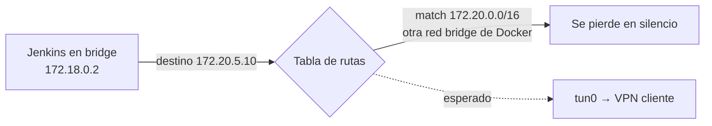

# Jenkins en Docker

## Imagen derivada

Fijar la versión (LTS) y agregar solo las herramientas que necesita el **controller** (no las de build: eso va en los agentes).

```dockerfile
FROM jenkins/jenkins:2.543-jdk17

USER root
RUN apt-get update && apt-get install -y --no-install-recommends \
        git curl unzip rsync jq openssh-client ca-certificates \
    && rm -rf /var/lib/apt/lists/*
USER jenkins
```

Pre-instalar plugins (opcional, para entornos reproducibles):

```dockerfile
COPY plugins.txt /usr/share/jenkins/ref/plugins.txt
RUN jenkins-plugin-cli --plugin-file /usr/share/jenkins/ref/plugins.txt
```

```text
# plugins.txt
workflow-aggregator
git
ssh-slaves
docker-plugin
lockable-resources
http_request
pipeline-utility-steps
sonar
artifactory
timestamper
ansicolor
ws-cleanup
```

---

## compose.yaml

```yaml
name: jenkins

services:
  jenkins:
    build: .
    image: miorg/jenkins:2.543-jdk17
    container_name: jenkins
    network_mode: host          # ver sección siguiente
    env_file:
      - ./config/.env
    restart: unless-stopped
    mem_limit: 8g
    cpus: 4
    volumes:
      - jenkins-home:/var/jenkins_home

volumes:
  jenkins-home:
    name: jenkins-home
```

```bash
# config/.env
JAVA_OPTS=-Xms512m -Xmx4g -Djenkins.install.runSetupWizard=false
JENKINS_OPTS=--httpPort=8080
```

| Opción | Para qué |
|--------|----------|
| `-Xmx` | Heap. Regla: ~50–75 % de `mem_limit`; el resto para metaspace, threads y off-heap |
| `-Djenkins.install.runSetupWizard=false` | Saltear el wizard cuando el `JENKINS_HOME` ya viene configurado (restore/migración) |
| `--httpPort` | Puerto HTTP (con `network_mode: host` no hay mapeo de puertos) |
| `-Dhudson.model.DirectoryBrowserSupport.CSP=...` | Relajar CSP para reportes HTML publicados |

---

## ¿Por qué `network_mode: host`?

Si el controller (o sus agentes) alcanzan redes de clientes a través de **VPNs del host** (OpenVPN `tun0`) y esas redes usan rangos `172.16.0.0/12`, chocan con el pool que Docker asigna por defecto a las redes bridge (`172.17.x`, `172.18.x`…).



Opciones:

| Opción | Pros | Contras |
|--------|------|---------|
| `network_mode: host` | Usa la tabla de rutas del host tal cual, igual que bare-metal | Sin aislamiento de red; puertos directo en el host |
| Cambiar el pool de Docker (`/etc/docker/daemon.json`) | Mantiene bridge | Hay que elegir un rango que no use ningún cliente |

```json
{
  "default-address-pools": [ { "base": "10.200.0.0/16", "size": 24 } ]
}
```

Diagnóstico:

```bash
ip route get 172.20.5.10          # ¿sale por tun0 o por br-xxxx?
docker network ls -q | xargs docker network inspect -f '{{.Name}} {{range .IPAM.Config}}{{.Subnet}}{{end}}'
```

---

## Permisos del volumen

El usuario `jenkins` de la imagen oficial es **uid/gid 1000**. Al copiar un `JENKINS_HOME` existente dentro del volumen:

```bash
MP=$(docker volume inspect jenkins-home --format '{{ .Mountpoint }}')
[ -n "$MP" ] || { echo "mountpoint vacío, abortando"; exit 1; }   # nunca operar sobre "/"
sudo rsync -a /var/lib/jenkins/ "$MP/"
sudo chown -R 1000:1000 "$MP"
```

---

## Migrar de bare-metal (`/var/lib/jenkins`) a Docker

1. `/quietDown` y esperar que terminen los builds.
2. `systemctl stop jenkins`.
3. Copiar `JENKINS_HOME` al volumen (excluir `workspace/` y, si se quiere, `jobs/*/builds/`).
4. `chown -R 1000:1000`.
5. Revisar rutas absolutas en configs (`/var/lib/jenkins` → `/var/jenkins_home`) en `config.xml` de nodos/tools.
6. `docker compose up -d --build` y validar `/login`, agentes y un build de prueba.
7. Si hay agentes con Docker Cloud apuntando a `tcp://<ip-vieja>:2375`, actualizar el `dockerHost`.

---

## Operación

```bash
docker compose up -d --build
docker logs -f jenkins
docker exec -it jenkins bash
docker exec jenkins cat /var/jenkins_home/secrets/initialAdminPassword   # primera instalación

# Actualizar versión: cambiar el tag en Dockerfile/compose y
docker compose build --pull && docker compose up -d

# Esperar a que responda (200 o 403 = vivo)
until curl -s -o /dev/null -w '%{http_code}' http://localhost:8080/login | grep -qE '200|403'; do sleep 10; done
```
