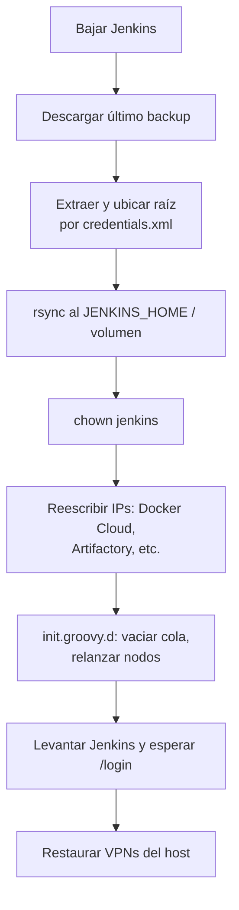

# Backup y DRP de Jenkins

## Qué respaldar

| Incluir | Motivo |
|---------|--------|
| `config.xml` | Config global, clouds, seguridad |
| `credentials.xml` **+** `secrets/` | Credenciales y la clave para descifrarlas (uno sin el otro no sirve) |
| `*.xml` de la raíz | Config de cada plugin (Artifactory, Sonar, Lockable Resources…) |
| `plugins/` | Mismas versiones exactas que producción |
| `nodes/` | Definición de agentes |
| `users/` | Usuarios locales y API tokens |
| `jobs/**/config.xml` | Definición de jobs y folders (incluye `credentials.xml` de folders) |
| `.ssh/` | known_hosts y claves del usuario jenkins |
| Configs externas que use el host (ej. `/etc/openvpn`) | Para que el DRP alcance las mismas redes |

| Excluir | Motivo |
|---------|--------|
| `workspace/`, `jobs/**/builds/` | Volumen enorme, regenerable |
| `queue.xml` | Builds pendientes contra nodos que en DRP no existen |
| `slave-status.xml`, `thinBackup.xml`, `periodicBackup.xml` | Estado efímero / de otros mecanismos de backup |
| Jobs que manejan datos voluminosos (ej. mirror de repos a NAS) | Opcional, según tamaño |

---

## Job de backup

Corre en el nodo `master` (o en el host, si es Docker) con `cron` diario.

```groovy
def DATE        = sh(script: 'date +%Y_%m_%d', returnStdout: true).trim()
def TEMP_DIR    = "${WORKSPACE}/tempJENKINS"
def BACKUP_FILE = "Backup-Jenkins-DRP_${DATE}.zip"
def JH          = '/var/lib/jenkins'

stage('Copy') {
    sh """
        mkdir -p ${TEMP_DIR}/jobs
        cp ${JH}/config.xml ${JH}/credentials.xml ${TEMP_DIR}/
        cp -r ${JH}/plugins ${JH}/secrets ${JH}/nodes ${JH}/users ${JH}/.ssh ${TEMP_DIR}/
        cd ${JH} && cp \$(ls *.xml | grep -Ev 'queue.xml|slave-status.xml|thinBackup.xml|periodicBackup.xml') ${TEMP_DIR}/
    """
    // Solo config.xml de jobs/folders, preservando la jerarquía
    sh """
        cd ${JH}/jobs
        find . -type f \\( -name config.xml -o -name credentials.xml \\) \
             ! -path '*/workspace/*' ! -path '*/builds/*' ! -path '*/lastStable/*' ! -path '*/lastSuccessful/*' |
        while read f; do
            mkdir -p "${TEMP_DIR}/jobs/\$(dirname "\$f")"
            cp "\$f" "${TEMP_DIR}/jobs/\$(dirname "\$f")/"
        done
    """
}

stage('Archive') {
    // cd primero: así el zip no guarda el path absoluto del workspace como prefijo
    sh "cd ${TEMP_DIR} && zip -qr ${WORKSPACE}/${BACKUP_FILE} ."
}
```

> Si el zip se arma con `zip -r out.zip /ruta/absoluta`, el archivo conserva toda la ruta del workspace como prefijo y el restore tiene que "buscar" la raíz. Mejor `cd` + `.`.

### Subida a Object Storage con rclone

Para OCI Object Storage (API S3-compatible) **no** usar `aws s3 cp` para archivos grandes: aws-cli/botocore recientes envían por defecto un checksum trailer con `aws-chunked` que OCI rechaza (`NotImplemented` en `UploadPart`). rclone usa su propio cliente S3, maneja multipart y reintentos.

```groovy
stage('Upload') {
    withCredentials([[$class: 'AmazonWebServicesCredentialsBinding', credentialsId: 'oci-s3-compat',
                      accessKeyVariable: 'RCLONE_CONFIG_DRP_ACCESS_KEY_ID',
                      secretKeyVariable: 'RCLONE_CONFIG_DRP_SECRET_ACCESS_KEY']]) {
        withEnv(['RCLONE_CONFIG_DRP_TYPE=s3',
                 'RCLONE_CONFIG_DRP_PROVIDER=Other',
                 "RCLONE_CONFIG_DRP_ENDPOINT=https://<namespace>.compat.objectstorage.<region>.oraclecloud.com",
                 'RCLONE_CONFIG_DRP_REGION=<region>']) {
            sh """
                export PATH="\$HOME/bin:\$PATH"
                if ! command -v rclone >/dev/null; then       # auto-instalación sin sudo
                    mkdir -p ~/bin
                    curl -fsSL https://downloads.rclone.org/v1.68.2/rclone-v1.68.2-linux-amd64.zip -o /tmp/rc.zip
                    unzip -oq /tmp/rc.zip -d /tmp/rc && cp /tmp/rc/rclone-*/rclone ~/bin/ && chmod +x ~/bin/rclone
                fi
                rclone copyto ${WORKSPACE}/${BACKUP_FILE} drp:mi-bucket/jenkins/${BACKUP_FILE} \
                    --retries 5 --low-level-retries 10 --stats 30s -v
            """
        }
    }
}
```

Retención (conservar los últimos N):

```bash
rclone lsf drp:mi-bucket/jenkins/ | sort | head -n -5 | while read f; do
  rclone deletefile "drp:mi-bucket/jenkins/$f"
done
```

> Un mismo Jenkinsfile parametrizado (`APP = JENKINS / GRAFANA / VAULT`) puede respaldar varias apps con un mapa de config por app (nodo, timeout, carpeta, extensión). Se crea un job por app para mantener triggers y permisos separados.

---

## Restore



### 1. Ubicar la raíz real del backup

```bash
# Si hay varios credentials.xml (folders), el de menor profundidad es la raíz de JENKINS_HOME
MARKER=$(find /tmp/restore -type f -name credentials.xml -printf '%d\t%p\n' | sort -n | head -1 | cut -f2-)
[ -n "$MARKER" ] || { echo "No se encontró credentials.xml"; exit 1; }
SRC=$(dirname "$MARKER")
```

### 2. Copiar y permisos

```bash
sudo rsync -a "$SRC/" "$JENKINS_HOME/"
sudo chown -R jenkins:jenkins "$JENKINS_HOME"      # o 1000:1000 en Docker
sudo rm -f "$JENKINS_HOME/queue.xml"
```

### 3. Reescribir direcciones del entorno original

```bash
CFG="$JENKINS_HOME/config.xml"
for old in 10.1.0.61 10.1.0.157; do
  sudo sed -i "s|tcp://${old}:2375|tcp://localhost:2375|g; s|<hostname>${old}</hostname>|<hostname>localhost</hostname>|g" "$CFG"
done

ART="$JENKINS_HOME/org.jfrog.hudson.ArtifactoryBuilder.xml"
sudo sed -i "s|//10.1.0.40:|//${NEW_ARTIFACTORY_IP}:|g" "$ART"
```

> La URL de Artifactory la usa el **agente**, no el controller: `localhost` sería el propio agente. Usar una IP alcanzable desde los nodos de build.

> Antes de asumir que la lista de IPs viejas está completa, verificar contra el `config.xml` real: `grep -oE 'tcp://[0-9.]+:2375' config.xml | sort -u`.

### 4. `init.groovy.d`: correcciones que no se pueden hacer con sed

Los scripts en `$JENKINS_HOME/init.groovy.d/*.groovy` corren en **cada arranque** con privilegios de sistema (sin necesitar credenciales del security realm restaurado).

Vaciar la cola reconstruida al bootear:

```groovy
// init.groovy.d/00-clear-queue.groovy
import jenkins.model.Jenkins
def q = Jenkins.instance.queue
def n = q.items.length
q.clear()
println "[DRP] Cola vaciada (${n} items descartados)."
```

Reemplazar el launcher de un nodo (ej. de inbound/JNLP en prod a SSH en DRP) y crear su credencial — imposible con `sed` porque el store de credenciales está cifrado. Ver el ejemplo completo de `SSHLauncher` en [Agentes y nodos](/article/jenkins/04-agentes-y-nodos/) y de credenciales en [Credenciales y secretos](/article/jenkins/05-credenciales-y-secretos/). La contraseña se lee de un `.properties` con permisos `600` fuera del repo (escrito por cloud-init), nunca embebida en el script.

> Como corre en cada boot, si alguien "arregla" el nodo a mano en la UI, el próximo arranque lo vuelve a dejar como define el script: la configuración del DRP queda como código.

### 5. Levantar y verificar

```bash
docker compose -f compose.yaml up -d --build      # o: systemctl restart jenkins
for i in $(seq 1 18); do
  code=$(curl -s -o /dev/null -w '%{http_code}' http://localhost:8080/login)
  [[ "$code" == 200 || "$code" == 403 ]] && break
  sleep 10
done
```

### 6. VPNs del host

```bash
sudo cp -r "$JENKINS_HOME/openvpn/." /etc/openvpn/
for conf in /etc/openvpn/*.conf; do
  name=$(basename "$conf" .conf)
  sudo systemctl enable --now "openvpn@${name}"
  systemctl is-active --quiet "openvpn@${name}" || echo "openvpn@${name} no levantó"
done
```

### 7. Imágenes de runners

Si los templates de Docker Cloud usan *Never pull*, el host DRP necesita las imágenes con el **mismo `nombre:tag`**. Buildearlas una vez (cloud-init `once-per-instance`) con `--build-arg JENKINS_AGENT_URL=http://localhost:8080/jnlpJars/agent.jar`, después de que Jenkins responda.

---

## Checklist de prueba de DRP

- [ ] El backup más reciente tiene < 24 h y abre sin errores.
- [ ] Login con un usuario real funciona.
- [ ] Credenciales se descifran (un job que use `withCredentials` corre).
- [ ] Agentes Windows/Linux conectados; un template de Docker Cloud provisiona.
- [ ] Build → upload a Artifactory → deploy de prueba OK.
- [ ] Cola vacía al arrancar; ningún job programado apunta a producción.
