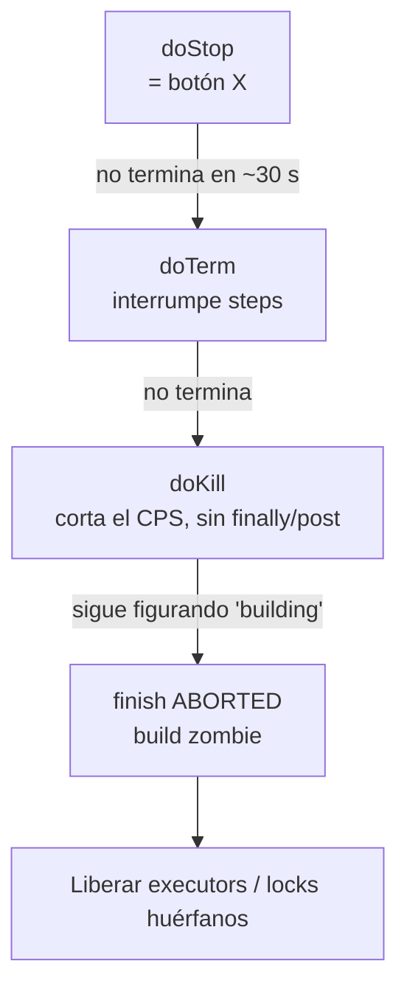

# Liberar un Job Colgado desde la Script Console

## Cuándo usarlo

- El botón **X (Abort)** no tiene efecto, o el build sigue en *"Aborting…"* durante minutos.
- El build figura en ejecución pero no hay nada corriendo (por ejemplo, después de un reinicio de Jenkins o de perder un agente).
- `disableConcurrentBuilds()` deja los builds nuevos en cola porque *"Build #N is already in progress"*.
- Un executor queda ocupado o un `lock()` no se libera.

Se abre **Manage Jenkins → Script Console** (`https://jenkins/script`). Hace falta el permiso *Overall/Administer*.

---

## Escalamiento



Siempre de menor a mayor: `doStop` y `doTerm` dejan que corran los `finally`/`post`, lo que sirve para limpiar workspaces y avisar. `doKill` y `finish` los saltean.

---

## Script principal (pegar y editar las 3 primeras líneas)

```groovy
import jenkins.model.Jenkins
import hudson.model.Result
import org.jenkinsci.plugins.workflow.job.WorkflowRun

def JOB_NAME = 'PLS/Backoffice-BE/deploy-bowas'   // ruta completa del job (con folders)
def BUILD_NUM = 123                                // número del build colgado
def LEVEL     = 'stop'                             // stop | term | kill | finish

def job = Jenkins.instance.getItemByFullName(JOB_NAME)
assert job != null : "No existe el job '${JOB_NAME}'"
def run = job.getBuildByNumber(BUILD_NUM)
assert run != null : "No existe el build #${BUILD_NUM}"

println "Estado antes: building=${run.isBuilding()} result=${run.getResult()} tipo=${run.class.simpleName}"

if (run instanceof WorkflowRun) {
    switch (LEVEL) {
        case 'stop':   run.doStop(); break                       // = botón X
        case 'term':   run.doTerm(); break                       // interrumpe los steps en curso
        case 'kill':   run.doKill(); break                       // corta la ejecución CPS sin finally/post
        case 'finish':                                           // zombie: no hay ejecución que matar
            run.finish(Result.ABORTED, new java.io.IOException("Cerrado manualmente desde Script Console"))
            run.save()
            break
        default: println "LEVEL inválido: ${LEVEL}"
    }
} else {
    // Freestyle / otros: interrumpir el executor que lo está corriendo
    def exec = run.getExecutor() ?: run.getOneOffExecutor()
    if (exec) { exec.interrupt(Result.ABORTED); println "Executor interrumpido" }
    else      { println "Sin executor asociado: desconectar/reconectar el agente o hacer safeRestart" }
}

sleep(3000)
println "Estado después: building=${run.isBuilding()} result=${run.getResult()}"
```

Se corre con `LEVEL = 'stop'`, se esperan unos segundos y, si `building` sigue en `true`, se sube a `term`, después a `kill` y por último a `finish`.

---

## Diagnóstico previo: ¿está vivo o es un zombie?

```groovy
import jenkins.model.Jenkins
def run = Jenkins.instance.getItemByFullName('PLS/Backoffice-BE/deploy-bowas').getBuildByNumber(123)

println "isBuilding   : ${run.isBuilding()}"
println "isInProgress : ${run.isInProgress()}"
println "execution    : ${run.getExecution()}"          // null = no hay pipeline corriendo → zombie
println "inicio       : ${new Date(run.getStartTimeInMillis())}"
println "executor     : ${run.getExecutor() ?: run.getOneOffExecutor()}"
```

| Resultado | Interpretación | Nivel a usar |
|-----------|----------------|--------------|
| `execution != null`, `isInProgress = true` | Vivo, probablemente esperando un step (`sh`, `input`, `lock`, agente) | `stop` → `term` → `kill` |
| `execution == null`, `isBuilding = true` | **Zombie**: no queda nada que matar | `finish` directo |

---

## Todos los builds colgados de un job (o de un folder)

```groovy
import jenkins.model.Jenkins
import hudson.model.Result
import org.jenkinsci.plugins.workflow.job.WorkflowJob

def ITEM    = 'PLS/Backoffice-BE/deploy-bowas'   // job o folder
def MIN_AGE = 60                                  // minutos
def DRY_RUN = true                                // primero en true para ver qué tocaría

def item = Jenkins.instance.getItemByFullName(ITEM)
def jobs = (item instanceof WorkflowJob) ? [item] : item.getAllJobs().findAll { it instanceof WorkflowJob }
long limit = System.currentTimeMillis() - MIN_AGE * 60_000L

jobs.each { job ->
    job.builds.findAll { it.isBuilding() && it.getStartTimeInMillis() < limit }.each { run ->
        def zombie = run.getExecution() == null
        println "${DRY_RUN ? 'DRY_RUN ' : ''}${job.fullName} #${run.number} zombie=${zombie}"
        if (!DRY_RUN) {
            if (zombie) {
                run.finish(Result.ABORTED, new java.io.IOException("Cerrado desde Script Console"))
                run.save()
            } else {
                run.doKill()
            }
        }
    }
}
```

---

## Executors que quedaron ocupados

Los pipelines usan dos tipos de executor: el **flyweight** del controller (`oneOffExecutors`, uno por build) y el executor del agente (dentro de cada `node {}`).

```groovy
import jenkins.model.Jenkins
import hudson.model.Result

def DRY_RUN = true

Jenkins.instance.computers.each { c ->
    (c.executors + c.oneOffExecutors).findAll { it.isBusy() }.each { e ->
        def work = e.currentExecutable
        println "${c.displayName ?: 'controller'} | ${work} | ocupado hace ${((long) (e.elapsedTime / 60000))} min"
        if (!DRY_RUN && e.isLikelyStuck()) {
            e.interrupt(Result.ABORTED)
            println "  → interrumpido"
        }
    }
}
```

> `isLikelyStuck()` compara la duración con el promedio histórico del job. Para forzar un executor puntual, sacar la condición e interrumpir solo el que corresponde a tu build.

---

## Lock que no se liberó (Lockable Resources)

Desde la UI: **Lockable Resources → Reset** sobre el recurso. Por script:

```groovy
import org.jenkins.plugins.lockableresources.LockableResourcesManager

def lrm = LockableResourcesManager.get()
lrm.getResources().findAll { it.isLocked() || it.isReserved() }.each {
    println "${it.name} | lockedBy=${it.build} | reservedBy=${it.reservedBy}"
}

def r = lrm.fromName('db-qa')          // nombre del recurso
if (r) { lrm.reset([r]); println "Reseteado: ${r.name}" }
```

---

## Sacarlo de la cola (si nunca llegó a arrancar)

```groovy
import jenkins.model.Jenkins
def q = Jenkins.instance.queue
q.items.findAll { it.task.fullName == 'PLS/Backoffice-BE/deploy-bowas' }.each {
    println "Cancelando de la cola: ${it.task.fullName} (${it.why})"
    q.cancel(it)
}
```

---

## Después de liberarlo

- Revisar `consoleText` del build para entender dónde se colgó: un `input` sin respuesta, `sh` esperando stdin, un agente perdido o un `lock`.
- Si fue por un agente caído, reconectarlo o marcarlo *temporarily offline* (ver [Script Console y watchdog](/article/jenkins/11-script-console-y-watchdog/)).
- Si pasa seguido, programar el watchdog de builds zombie en vez de liberarlos a mano.
- Último recurso si nada funciona: `Jenkins.instance.doSafeRestart(null)`, que espera a los builds sanos y descarta los colgados al reiniciar.
