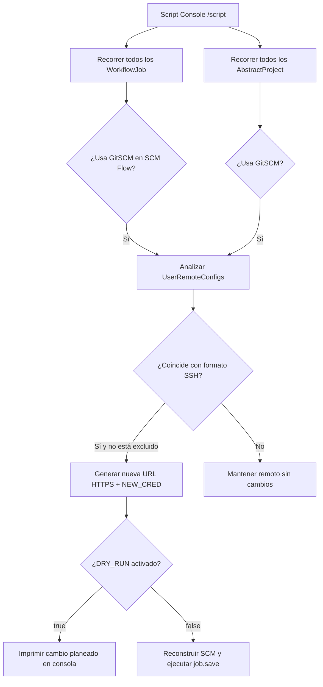

# Migración Masiva de Repositorios Git (SSH a HTTPS) desde la Script Console

Cuando se migran esquemas de autenticación en la organización (por ejemplo, pasando de llaves SSH distribuidas a Personal Access Tokens o contraseñas de servicio HTTPS centralizadas en Jenkins Credentials), actualizar manualmente decenas o cientos de jobs desde la interfaz web no es viable.

Este script en Groovy se ejecuta directamente en el controller desde **Manage Jenkins → Script Console** (`/script`) o mediante un pipeline de administración. Recorre todos los jobs de Jenkins (tanto **Pipelines** como **Freestyle**), transforma las URLs remotas de SSH a HTTPS, asigna el nuevo ID de credencial y guarda los cambios en disco sin necesidad de reiniciar la instancia.

---

## Cuándo usar esta migración

- **Transición a Tokens HTTPS / App Passwords:** Reemplazo de llaves SSH (`git@...` o `ssh://git@...`) por tokens con permisos granulares (read-only/repo-scope) gestionados como credencial `Username with password` o `Secret text`.
- **Restricciones de red y firewalls:** Entornos corporativos o nodos de compilación donde la salida por puerto 22 (SSH) hacia Bitbucket, GitHub o GitLab está bloqueada o restringida, mientras que el puerto 443 (HTTPS) está habilitado.
- **Estandarización de credenciales:** Unificar un ID de credencial común en lugar de credenciales dispersas o desactualizadas entre carpetas y subproyectos.

---

## Cómo funciona el script



1. **Expresión regular flexible:** Detecta tanto sintaxis SCP (`git@bitbucket.org:org/repo.git`) como sintaxis URI (`ssh://git@bitbucket.org/org/repo.git`).
2. **Filtro de exclusiones:** Permite conservar en SSH repositorios críticos o que pertenecen a otra organización (por ejemplo, repositorios de infraestructura o Shared Libraries) mediante condiciones como `!url.contains('...')`.
3. **Preservación de metadatos SCM:** Al crear la nueva instancia de `GitSCM`, se conservan las ramas configuradas (`scm.branches`), el visualizador de repositorio (`scm.browser`), la herramienta Git asociada (`scm.gitTool`) y las extensiones (`scm.extensions`).
4. **Preservación de Lightweight Checkout:** En los pipelines (`WorkflowJob`), actualiza la definición `CpsScmFlowDefinition` asegurando que `nd.lightweight = d.lightweight` no se pierda, manteniendo el checkout rápido del Jenkinsfile.
5. **Modo Dry-Run seguro:** La variable `DRY_RUN = true` por defecto lista exactamente qué jobs y URLs cambiarían sin tocar la configuración.

---

## Script Groovy completo

Abrir **Manage Jenkins → Script Console** (requiere permiso de administrador) y ejecutar:

```groovy
import jenkins.model.Jenkins
import hudson.model.AbstractProject
import hudson.plugins.git.GitSCM
import hudson.plugins.git.UserRemoteConfig
import org.jenkinsci.plugins.workflow.job.WorkflowJob
import org.jenkinsci.plugins.workflow.cps.CpsScmFlowDefinition

// Parámetros de configuración
def DRY_RUN  = true                  // Cambiar a false únicamente tras revisar el resultado
def NEW_CRED = 'bitbucket-https'      // ID de la credencial HTTPS preexistente en Jenkins

// Transforma:
//   ssh://git@bitbucket.org/org/repo.git  -> https://bitbucket.org/org/repo.git
//   git@bitbucket.org:org/repo.git        -> https://bitbucket.org/org/repo.git
def toHttps = { String url ->
    def m = (url =~ /^(?:ssh:\/\/)?git@bitbucket\.org[:\/](.+)$/)
    // Excluir repositorios específicos que deban seguir usando SSH o tengan otra credencial
    (m && !url.contains('otro-workspace')) ? "https://bitbucket.org/${m[0][1]}" : null
}

def migrate = { GitSCM scm ->
    def changed = false
    def remotes = scm.userRemoteConfigs.collect { rc ->
        def u = toHttps(rc.url)
        if (!u) return rc
        changed = true
        new UserRemoteConfig(u, rc.name, rc.refspec, NEW_CRED)
    }
    changed ? new GitSCM(remotes, scm.branches, scm.browser, scm.gitTool, scm.extensions) : null
}

def n = 0

// 1. Migración de Pipelines (WorkflowJob con Jenkinsfile en SCM)
Jenkins.instance.getAllItems(WorkflowJob).each { job ->
    def d = job.definition
    if (!(d instanceof CpsScmFlowDefinition) || !(d.scm instanceof GitSCM)) return
    def newScm = migrate(d.scm)
    if (!newScm) return
    println "[pipeline] ${job.fullName}: ${d.scm.userRemoteConfigs*.url} -> ${newScm.userRemoteConfigs*.url}"
    n++
    if (!DRY_RUN) {
        def nd = new CpsScmFlowDefinition(newScm, d.scriptPath)
        nd.lightweight = d.lightweight
        job.definition = nd
        job.save()
    }
}

// 2. Migración de Freestyle Jobs (AbstractProject)
Jenkins.instance.getAllItems(AbstractProject).each { job ->
    if (!(job.scm instanceof GitSCM)) return
    def newScm = migrate(job.scm)
    if (!newScm) return
    println "[freestyle] ${job.fullName}: ${job.scm.userRemoteConfigs*.url} -> ${newScm.userRemoteConfigs*.url}"
    n++
    if (!DRY_RUN) {
        job.scm = newScm
        job.save()
    }
}

println "${DRY_RUN ? 'DRY RUN - ' : ''}${n} jobs"
```

---

## Ejemplo de salida (Dry Run)

Al ejecutar con `DRY_RUN = true`, la consola muestra cada job identificado con la ruta anterior y la nueva URL resultante:

```text
[pipeline] Tools/deploy-backend: [ssh://git@bitbucket.org/mi-workspace/devops.git] -> [https://bitbucket.org/mi-workspace/devops.git]
[pipeline] Tools/deploy-frontend: [ssh://git@bitbucket.org/mi-workspace/devops.git] -> [https://bitbucket.org/mi-workspace/devops.git]
[pipeline] Builds/build-api: [ssh://git@bitbucket.org/mi-workspace/devops.git] -> [https://bitbucket.org/mi-workspace/devops.git]
[freestyle] Hooks/ApiHook: [ssh://git@bitbucket.org/mi-workspace/api] -> [https://bitbucket.org/mi-workspace/api]
[freestyle] Hooks/WebHook: [ssh://git@bitbucket.org/mi-workspace/web] -> [https://bitbucket.org/mi-workspace/web]
DRY RUN - 174 jobs
```

---

## Adaptaciones comunes

### Adaptar a GitHub o GitLab

Si los repositorios están alojados en GitHub o en una instancia GitLab auto-gestionada, cambiar la closure `toHttps`:

```groovy
// Para GitHub
def toHttps = { String url ->
    def m = (url =~ /^(?:ssh:\/\/)?git@github\.com[:\/](.+)$/)
    m ? "https://github.com/${m[0][1]}" : null
}

// Para GitLab (SaaS o Self-Managed)
def toHttps = { String url ->
    def m = (url =~ /^(?:ssh:\/\/)?git@gitlab\.empresa\.com[:\/](.+)$/)
    m ? "https://gitlab.empresa.com/${m[0][1]}" : null
}
```

### Proceso de aplicación recomendado

1. **Verificar credenciales previas:** Asegurarse de que el `credentialsId` configurado en `NEW_CRED` exista en el ámbito global o en la carpeta raíz de Jenkins con permisos de lectura para los repositorios.
2. **Ejecutar en modo lectura (`DRY_RUN = true`):** Verificar el total de jobs encontrados y que no se incluyan repositorios que requieran mantenerse en SSH.
3. **Hacer backup de `$JENKINS_HOME`:** Especialmente el directorio de configuración de jobs (`$JENKINS_HOME/jobs/`).
4. **Aplicar cambios (`DRY_RUN = false`):** Ejecutar el script. `job.save()` sobrescribe los archivos `config.xml` correspondientes de forma inmediata.
5. **Comprobar un job de prueba:** Disparar un build manual en un pipeline y en un freestyle job para validar que la clonación por HTTPS con la nueva credencial se realice satisfactoriamente.

---

## Lo que el script no cubre (y en un Jenkins real aparece)

El script de arriba solo migra el **SCM del job**, es decir, de dónde baja su propio Jenkinsfile. En una instalación con años de uso hay otros cuatro lugares con URLs por SSH. Si no se migran, el día que se corta el SSH fallan igual:

| Dónde | Cómo se ve | Qué pasa si queda en SSH |
|---|---|---|
| **Shared library global** | *Manage Jenkins → System → Global Pipeline Libraries* → `ssh://git@...` | Fallan **todos** los pipelines que hacen `@Library('...')` |
| **Parámetros que listan ramas** (plugin *List Git Branches*, *Git Parameter*) | `<remoteURL>ssh://git@...</remoteURL>` + `<credentialsId>` propio dentro de `ParametersDefinitionProperty` | El combo de ramas queda vacío y no se puede lanzar el build |
| **Pipelines inline** (*Pipeline script* en vez de *from SCM*) | `git url: 'ssh://...', credentialsId: '...'` dentro de `<script>` en el `config.xml` | Falla el checkout |
| **Jenkinsfiles del repo** | `checkout([... userRemoteConfigs: [[url: 'ssh://...']]])`, `git url:` y variables `REPO_X = "ssh://..."` | Fallan los checkouts dentro del pipeline |

### El caso que se escapa: submódulos

El `.gitmodules` vive en los repos de los desarrolladores, no en Jenkins ni en el repo de pipelines, así que ningún relevamiento sobre Jenkins lo encuentra. Si dice `url = git@bitbucket.org:mi-workspace/core.git`, después de migrar el clon principal a HTTPS el submódulo sigue yendo por SSH y falla:

```
fatal: clone of 'git@bitbucket.org:mi-workspace/core.git' into submodule path '.../core' failed
git@bitbucket.org: Permission denied (publickey).
```

No hace falta tocar los repos de los devs: antes del checkout, un `insteadOf` en el agente reescribe la URL a HTTPS, y `SubmoduleOption(parentCredentials: true)` le pasa al submódulo la credencial del padre. Funciona con git viejo (2.25) y en agentes efímeros:

```groovy
// vars/gitHttpsSubmodules.groovy
def call() {
    String k = 'url.https://bitbucket.org/mi-workspace/.insteadOf'
    if (isUnix()) {
        sh "git config --global --unset-all ${k} || true; git config --global --add ${k} git@bitbucket.org:mi-workspace/; git config --global --add ${k} ssh://git@bitbucket.org/mi-workspace/"
    } else {
        bat "@echo off
git config --global --unset-all ${k}
git config --global --add ${k} git@bitbucket.org:mi-workspace/
git config --global --add ${k} ssh://git@bitbucket.org/mi-workspace/
exit /b 0"
    }
}
// en el pipeline, dentro del node y antes del checkout:
gitHttpsSubmodules()
checkout([$class: 'GitSCM', ..., extensions: [[$class: 'SubmoduleOption', parentCredentials: true, recursiveSubmodules: true]]])
```

Conviene limitarlo al workspace propio (`mi-workspace/`), para no reescribir repos de otros workspaces que todavía usen SSH a propósito.

### 1. Relevar todo antes de tocar nada

Este script es de solo lectura: recorre el `config.xml` de cada item (sin las ramas de las multibranch, que heredan del padre) y la config de librerías globales.

```groovy
import jenkins.model.Jenkins
def rx = ~/(ssh:\/\/[^<\s"']+|git@[A-Za-z0-9.-]+:[^<\s"']+)/
def gl = new File(Jenkins.get().rootDir, 'org.jenkinsci.plugins.workflow.libs.GlobalLibraries.xml')
if (gl.exists()) (gl.text =~ rx).each { println "GLOBAL-LIB | ${it[0]}" }
int total = 0, conSsh = 0
Jenkins.get().getAllItems(hudson.model.AbstractItem).each { item ->
    if (item.parent instanceof jenkins.branch.MultiBranchProject) return
    def f = item.configFile?.file
    if (!f?.exists()) return
    total++
    def hits = (f.text =~ rx).collect { it[0] }.unique()
    if (hits) { conSsh++; println "${item.fullName} | ${hits.take(3).join(' , ')}" }
}
println "items=${total} con SSH=${conSsh}"
```

Para saber **en qué parte** del job está el SSH: si `job.definition` es `CpsFlowDefinition`, es un pipeline inline. Si es `CpsScmFlowDefinition` y el SCM ya está en HTTPS, casi siempre es un parámetro.

> La Script Console por API (`/scriptText`) suele quedar detrás de un proxy o CDN con timeout de unos 100 s. Si el relevamiento tarda más, guardá el resultado en un archivo del controller y leelo con otra llamada.

### 2. Parámetros y pipelines inline: reemplazo sobre el `config.xml`

Acá conviene no armar objetos Groovy. Lo más simple y verificable es bajar el `config.xml` por REST, reemplazar texto y volver a subirlo, con respaldo:

```python
import re, requests
SSH = re.compile(r"(?:ssh://git@bitbucket\.org/|git@bitbucket\.org:)mi-workspace/")
def migrar(job_path, auth, base):
    xml = requests.get(f"{base}{job_path}/config.xml", auth=auth).content.decode("utf-8")
    open(job_path.strip("/").replace("/", "__") + ".bak.xml", "w", encoding="utf-8").write(xml)   # respaldo
    new = SSH.sub("https://bitbucket.org/mi-workspace/", xml)
    new = new.replace("<credentialsId>bitbucket-ssh</credentialsId>", "<credentialsId>bitbucket-https</credentialsId>")
    # en scripts inline las comillas vienen escapadas en el XML (&apos; / &quot;)
    new = re.sub(r"(credentialsId\s*:\s*(?:&apos;|&quot;|'|\"))bitbucket-ssh((?:&apos;|&quot;|'|\"))", r"\1bitbucket-https\2", new)
    if new != xml:
        requests.post(f"{base}{job_path}/config.xml", auth=auth, data=new.encode("utf-8"),
                      headers={"Content-Type": "application/xml; charset=utf-8"}).raise_for_status()
```

Para verificar el parámetro sin lanzar un build, consultá el endpoint que llena el combo. Tiene que devolver la lista de ramas:

```
GET /job/<job>/descriptorByName/com.syhuang.hudson.plugins.listgitbranchesparameter.ListGitBranchesParameterDefinition/fillValueItems?param=BRANCH_NAME
```

### 3. Shared library global

La library la usan todos los pipelines, así que va **una sola vez y con prueba inmediata**. Podés hacerlo desde la UI o desde la Script Console, conservando el id, la versión por defecto y las opciones:

```groovy
import org.jenkinsci.plugins.workflow.libs.*
import jenkins.plugins.git.GitSCMSource
import jenkins.plugins.git.traits.BranchDiscoveryTrait
def gl = GlobalLibraries.get()
gl.libraries = gl.libraries.collect { lc ->
    if (lc.name != 'mi-library') return lc
    def src = new GitSCMSource('https://bitbucket.org/mi-workspace/mi-library.git')
    src.id = lc.retriever.scm.id
    src.credentialsId = 'bitbucket-https'
    src.traits = [new BranchDiscoveryTrait()]
    def r = new SCMSourceRetriever(src); r.libraryPath = lc.retriever.libraryPath
    def n = new LibraryConfiguration(lc.name, r)
    n.defaultVersion = lc.defaultVersion; n.implicit = lc.implicit
    n.allowVersionOverride = lc.allowVersionOverride; n.includeInChangesets = lc.includeInChangesets
    n
}
gl.save()
```

Después lanzá cualquier build que use la library y buscá en el log `Loading library ...` seguido de `using credential bitbucket-https` y la URL `https://`.

### Orden que funcionó

1. **Piloto con un job:** migrar su parámetro y el checkout de su Jenkinsfile y lanzarlo a mano.
2. **Repo:** el reemplazo en una rama, revisando que el diff solo cambie URLs y credenciales, y el merge.
3. **Jobs** por API (parámetros e inline), con un simulacro primero.
4. **Library global** y un build de prueba.
5. **Relevar de nuevo:** tiene que dar `con SSH=0`.
6. **Borrar la credencial SSH** recién después de una ventana sin incidentes (por ejemplo, una semana de builds normales).
