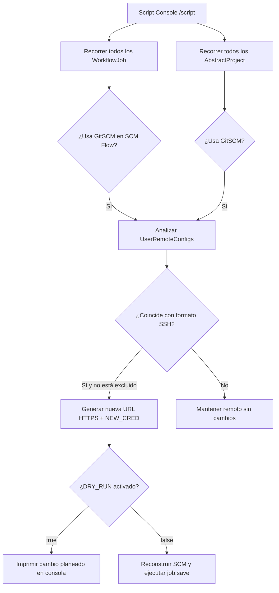

# Migración Masiva de Repositorios Git (SSH a HTTPS) desde la Script Console

Cuando se migran esquemas de autenticación en la organización (por ejemplo, pasando de llaves SSH distribuidas a Personal Access Tokens o contraseñas de servicio HTTPS centralizadas en Jenkins Credentials), actualizar manualmente decenas o cientos de jobs desde la interfaz web no es viable.

Este script en Groovy se ejecuta directamente en el controller desde **Manage Jenkins → Script Console** (`/script`) o mediante un pipeline de administración. Recorre todos los jobs de Jenkins (tanto **Pipelines** como **Freestyle**), transforma las URLs remotas de SSH a HTTPS, asigna el nuevo ID de credencial y guarda los cambios en disco sin necesidad de reiniciar la instancia.

---

## Cuándo usar esta migración

- **Transición a Tokens HTTPS / App Passwords:** Reemplazo de llaves SSH (`git@...` o `ssh://git@...`) por tokens con permisos granulares (read-only/repo-scope) gestionados como credencial `Username with password` o `Secret text`.
- **Restricciones de red y firewalls:** Entornos corporativos o nodos de compilación donde la salida por puerto 22 (SSH) hacia Bitbucket, GitHub o GitLab está bloqueada o restringida, mientras que el puerto 443 (HTTPS) está habilitado.
- **Estandarización de credenciales:** Unificar un ID de credencial común en lugar de credenciales dispersas o desactualizadas entre carpetas y subproyectos.

---

## Cómo funciona el script



1. **Expresión regular flexible:** Detecta tanto sintaxis SCP (`git@bitbucket.org:org/repo.git`) como sintaxis URI (`ssh://git@bitbucket.org/org/repo.git`).
2. **Filtro de exclusiones:** Permite conservar en SSH repositorios críticos o que pertenecen a otra organización (por ejemplo, repositorios de infraestructura o Shared Libraries) mediante condiciones como `!url.contains('...')`.
3. **Preservación de metadatos SCM:** Al crear la nueva instancia de `GitSCM`, se conservan las ramas configuradas (`scm.branches`), el visualizador de repositorio (`scm.browser`), la herramienta Git asociada (`scm.gitTool`) y las extensiones (`scm.extensions`).
4. **Preservación de Lightweight Checkout:** En los pipelines (`WorkflowJob`), actualiza la definición `CpsScmFlowDefinition` asegurando que `nd.lightweight = d.lightweight` no se pierda, manteniendo el checkout rápido del Jenkinsfile.
5. **Modo Dry-Run seguro:** La variable `DRY_RUN = true` por defecto lista exactamente qué jobs y URLs cambiarían sin tocar la configuración.

---

## Script Groovy completo

Abrir **Manage Jenkins → Script Console** (requiere permiso de administrador) y ejecutar:

```groovy
import jenkins.model.Jenkins
import hudson.model.AbstractProject
import hudson.plugins.git.GitSCM
import hudson.plugins.git.UserRemoteConfig
import org.jenkinsci.plugins.workflow.job.WorkflowJob
import org.jenkinsci.plugins.workflow.cps.CpsScmFlowDefinition

// Parámetros de configuración
def DRY_RUN  = true                  // Cambiar a false únicamente tras revisar el resultado
def NEW_CRED = 'devopsMultigame'      // ID de la credencial HTTPS preexistente en Jenkins

// Transforma:
//   ssh://git@bitbucket.org/org/repo.git  -> https://bitbucket.org/org/repo.git
//   git@bitbucket.org:org/repo.git        -> https://bitbucket.org/org/repo.git
def toHttps = { String url ->
    def m = (url =~ /^(?:ssh:\/\/)?git@bitbucket\.org[:\/](.+)$/)
    // Excluir repositorios específicos que deban seguir usando SSH o tengan otra credencial
    (m && !url.contains('winsysgroupdevops')) ? "https://bitbucket.org/${m[0][1]}" : null
}

def migrate = { GitSCM scm ->
    def changed = false
    def remotes = scm.userRemoteConfigs.collect { rc ->
        def u = toHttps(rc.url)
        if (!u) return rc
        changed = true
        new UserRemoteConfig(u, rc.name, rc.refspec, NEW_CRED)
    }
    changed ? new GitSCM(remotes, scm.branches, scm.browser, scm.gitTool, scm.extensions) : null
}

def n = 0

// 1. Migración de Pipelines (WorkflowJob con Jenkinsfile en SCM)
Jenkins.instance.getAllItems(WorkflowJob).each { job ->
    def d = job.definition
    if (!(d instanceof CpsScmFlowDefinition) || !(d.scm instanceof GitSCM)) return
    def newScm = migrate(d.scm)
    if (!newScm) return
    println "[pipeline] ${job.fullName}: ${d.scm.userRemoteConfigs*.url} -> ${newScm.userRemoteConfigs*.url}"
    n++
    if (!DRY_RUN) {
        def nd = new CpsScmFlowDefinition(newScm, d.scriptPath)
        nd.lightweight = d.lightweight
        job.definition = nd
        job.save()
    }
}

// 2. Migración de Freestyle Jobs (AbstractProject)
Jenkins.instance.getAllItems(AbstractProject).each { job ->
    if (!(job.scm instanceof GitSCM)) return
    def newScm = migrate(job.scm)
    if (!newScm) return
    println "[freestyle] ${job.fullName}: ${job.scm.userRemoteConfigs*.url} -> ${newScm.userRemoteConfigs*.url}"
    n++
    if (!DRY_RUN) {
        job.scm = newScm
        job.save()
    }
}

println "${DRY_RUN ? 'DRY RUN - ' : ''}${n} jobs"
```

---

## Ejemplo de salida (Dry Run)

Al ejecutar con `DRY_RUN = true`, la consola muestra cada job identificado con la ruta anterior y la nueva URL resultante:

```text
[pipeline] Automation/PW_DailyRegression_Orchestrator: [ssh://git@bitbucket.org/winsyslottery/devops.git] -> [https://bitbucket.org/winsyslottery/devops.git]
[pipeline] Docker/IPLS-Docker/deploy-Backoffice-Docker: [ssh://git@bitbucket.org/winsyslottery/devops.git] -> [https://bitbucket.org/winsyslottery/devops.git]
[pipeline] Docker/IPLS-Docker/deploy-GameEngine-Docker: [ssh://git@bitbucket.org/winsyslottery/devops.git] -> [https://bitbucket.org/winsyslottery/devops.git]
[pipeline] Docker/IPLS-Docker/deploy-iPLS-Docker: [ssh://git@bitbucket.org/winsyslottery/devops.git] -> [https://bitbucket.org/winsyslottery/devops.git]
[pipeline] iCasino/mastercache/build-coreplatform: [ssh://git@bitbucket.org/winsyslottery/devops.git] -> [https://bitbucket.org/winsyslottery/devops.git]
[pipeline] iCasino/mastercache/deploy-AdminWebApi: [ssh://git@bitbucket.org/winsyslottery/devops.git] -> [https://bitbucket.org/winsyslottery/devops.git]
[pipeline] iLottery/webserver/build-Backoffice: [ssh://git@bitbucket.org/winsyslottery/devops.git] -> [https://bitbucket.org/winsyslottery/devops.git]
[freestyle] Hooks/AgentSystem1.1Hook: [ssh://git@bitbucket.org/winsyslottery/agentsystem1.1] -> [https://bitbucket.org/winsyslottery/agentsystem1.1]
[freestyle] Hooks/AppcUIHook: [ssh://git@bitbucket.org/winsyslottery/appc] -> [https://bitbucket.org/winsyslottery/appc]
[freestyle] Hooks/BackofficeHook: [ssh://git@bitbucket.org/winsyslottery/backoffice] -> [https://bitbucket.org/winsyslottery/backoffice]
[freestyle] Hooks/GamingwebsiteHook: [ssh://git@bitbucket.org/winsyslottery/gamingwebsite] -> [https://bitbucket.org/winsyslottery/gamingwebsite]
DRY RUN - 174 jobs
```

---

## Adaptaciones comunes

### Adaptar a GitHub o GitLab

Si los repositorios están alojados en GitHub o en una instancia GitLab auto-gestionada, cambiar la closure `toHttps`:

```groovy
// Para GitHub
def toHttps = { String url ->
    def m = (url =~ /^(?:ssh:\/\/)?git@github\.com[:\/](.+)$/)
    m ? "https://github.com/${m[0][1]}" : null
}

// Para GitLab (SaaS o Self-Managed)
def toHttps = { String url ->
    def m = (url =~ /^(?:ssh:\/\/)?git@gitlab\.empresa\.com[:\/](.+)$/)
    m ? "https://gitlab.empresa.com/${m[0][1]}" : null
}
```

### Proceso de aplicación recomendado

1. **Verificar credenciales previas:** Asegurarse de que el `credentialsId` configurado en `NEW_CRED` exista en el ámbito global o en la carpeta raíz de Jenkins con permisos de lectura para los repositorios.
2. **Ejecutar en modo lectura (`DRY_RUN = true`):** Verificar el total de jobs encontrados y que no se incluyan repositorios que requieran mantenerse en SSH.
3. **Hacer backup de `$JENKINS_HOME`:** Especialmente el directorio de configuración de jobs (`$JENKINS_HOME/jobs/`).
4. **Aplicar cambios (`DRY_RUN = false`):** Ejecutar el script. `job.save()` sobrescribe los archivos `config.xml` correspondientes de forma inmediata.
5. **Comprobar un job de prueba:** Disparar un build manual en un pipeline y en un freestyle job para validar que la clonación por HTTPS con la nueva credencial se realice satisfactoriamente.
