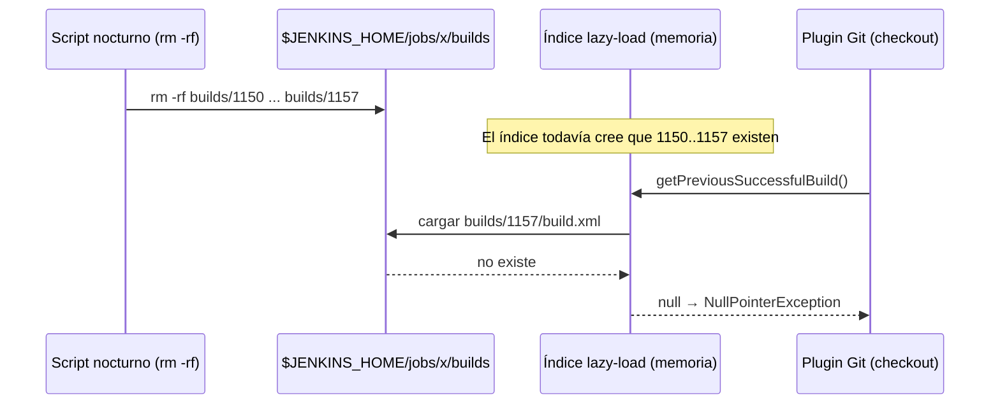

# NullPointerException en el checkout de Git por builds borrados en disco

Un síntoma desconcertante: un pipeline que funciona bien **falla "a veces"** justo después del `checkout`, sin haber compilado nada, con un stack trace interno de Jenkins. Al día siguiente vuelve a funcionar solo. La causa más común es **un proceso externo que borra carpetas de builds directo en disco** (`rm -rf $JENKINS_HOME/jobs/*/builds/N`) en lugar de dejar que Jenkins las borre.

---

## Síntoma

El build termina en `FAILURE` inmediatamente después de `Checking out Revision ...`:

```text
Commit message: "Merged in feature-x (pull request #1247)"
[Pipeline] }
[Pipeline] // stage
...
[Pipeline] End of Pipeline
java.lang.NullPointerException
	at java.base/java.util.Objects.requireNonNull(Objects.java:209)
	at java.base/java.util.Optional.of(Optional.java:113)
	at java.base/java.util.stream.FindOps$FindSink$OfRef.get(FindOps.java:194)
	...
	at jenkins.model.lazy.AbstractLazyLoadRunMap.search(AbstractLazyLoadRunMap.java:342)
	at jenkins.model.lazy.LazyBuildMixIn$RunMixIn.getPreviousBuild(LazyBuildMixIn.java:362)
	at org.jenkinsci.plugins.workflow.job.WorkflowRun.getPreviousBuild(WorkflowRun.java:279)
	at hudson.model.Run.getPreviousSuccessfulBuild(Run.java:891)
	at hudson.plugins.git.GitSCM.getLastSuccessfulBuiltCommitOfBranch(GitSCM.java:1626)
	at hudson.plugins.git.GitSCM.buildEnvironment(GitSCM.java:1560)
	...
Finished: FAILURE
```

Pistas clave:

- La excepción sale de **`AbstractLazyLoadRunMap`** (el índice de builds de Jenkins), no del código del proyecto.
- El llamador es el **plugin de Git**: después del checkout recorre los builds anteriores (`getPreviousSuccessfulBuild`) para calcular el changelog y `GIT_PREVIOUS_SUCCESSFUL_COMMIT`.
- Es **intermitente** y suele aparecer **la mañana siguiente** a una limpieza nocturna.

---

## Por qué pasa

Jenkins carga el historial de builds de forma *lazy*: guarda en memoria un índice de los números de build que existen y carga cada `build.xml` recién cuando alguien lo necesita.



El índice en memoria queda desincronizado con el disco hasta que el job se recarga (reinicio de Jenkins, *Reload Configuration from Disk* o un tiempo después). Por eso falla solo en algunos builds.

Un script típico que lo provoca:

```bash
# ❌ No hacer esto: borra builds por fuera de Jenkins
find /var/lib/jenkins/jobs -type d -path "*/builds/*" -name "[0-9]*" | while read -r build; do
  if [ "$(stat -c %Y "$build/build.xml")" -lt "$(date --date='-1 month' +%s)" ]; then
    rm -rf "$build"
  fi
done
```

---

## Cómo confirmarlo

1. **Correlacionar horarios**: comparar la hora de los builds fallidos con las ejecuciones del job/cron de limpieza. Si los fallos son las primeras ejecuciones después de la limpieza, es casi seguro.
2. **Buscar el script**: cualquier `rm -rf` sobre `jobs/*/builds/*`, `find ... -delete` o similar en jobs de mantenimiento o cron del controller.
3. **Revisar el estado en disco vs. Jenkins** (solo lectura, desde *Manage Jenkins → Script Console*):

```groovy
import jenkins.model.Jenkins

['carpeta/mi-job-1', 'carpeta/mi-job-2'].each { name ->
    def job = Jenkins.instance.getItemByFullName(name)
    def dir = job.buildDir
    def nums = (dir.listFiles() ?: []).findAll { it.isDirectory() && it.name ==~ /\d+/ }.collect { it.name as int }.sort()
    def noXml = nums.findAll { !new File(dir, "${it}/build.xml").exists() }
    def broken = nums.findAll { n -> try { job.getBuildByNumber(n) == null } catch (e) { true } }
    println "${name} | en disco: ${nums.size()} (${nums ? nums.first() : '-'}..${nums ? nums.last() : '-'}) | sin build.xml: ${noXml} | no cargan: ${broken}"
}
return null
```

> El problema es intermitente: es normal que este chequeo dé todo OK si se corre lejos de la limpieza. Lo que confirma el diagnóstico es la correlación de horarios y la existencia del `rm -rf`.

---

## Solución: que Jenkins borre los builds

### Opción 1 (recomendada): Global Build Discarder

Desde Jenkins 2.2xx existe una política global que aplica a todos los jobs sin tocar su configuración:

**Manage Jenkins → System → Global Build Discarders → Add → Default Build Discarder**

- *Days to keep builds*: `30`
- (opcional) *Max # of builds to keep*: según el disco disponible.

Jenkins aplica la política al terminar cada build y borra con su propia API (`Run.delete()`), manteniendo el índice coherente. Después de activarla, **eliminar el script de `rm -rf`**.

> Los jobs que tienen su propio `buildDiscarder(logRotator(...))` siguen usando su política. *Specific Build Discarder* solo afecta a los que no tienen una.

### Opción 2: limpieza con Groovy (si se necesita un job programado)

Si se quiere mantener un job nocturno de limpieza, que use la API de Jenkins en lugar del filesystem:

```groovy
import jenkins.model.Jenkins
import hudson.model.Job

def DRY_RUN = true
def DAYS = 30
def limit = System.currentTimeMillis() - DAYS * 24L * 3600 * 1000
def n = 0

Jenkins.instance.getAllItems(Job).each { job ->
    def keep = [job.lastSuccessfulBuild, job.lastStableBuild, job.lastBuild].findAll { it }*.number
    job.builds.findAll { it.timeInMillis < limit && !it.isBuilding() && !it.isKeepLog() && !(it.number in keep) }.each { run ->
        println "${DRY_RUN ? '[DRY] ' : ''}${job.fullName} #${run.number}"
        n++
        if (!DRY_RUN) { run.delete() }
    }
}
println "${DRY_RUN ? 'DRY RUN - ' : ''}${n} builds"
return null
```

Se conserva siempre el último build exitoso, el último estable y el último (los usan el plugin de Git y los links `lastSuccessfulBuild`), y se respetan los builds marcados con *Keep this build forever*.

---

## Resumen

| Mal | Bien |
|---|---|
| `rm -rf jobs/*/builds/N` desde cron o un job | Global Build Discarder, `buildDiscarder(logRotator(...))` o `run.delete()` |
| Índice en memoria desincronizado → NPE intermitente | Jenkins actualiza el índice al borrar |
| Puede borrar el último build exitoso que usa Git | Se conservan `lastSuccessfulBuild` y `lastStableBuild` |

Relacionado: [Mantenimiento y limpieza](/article/jenkins/10-mantenimiento-y-limpieza/), [Script Console y watchdog](/article/jenkins/11-script-console-y-watchdog/), [Troubleshooting](/article/jenkins/12-troubleshooting/).
