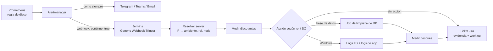

# Remediación automática de alertas de disco: Alertmanager → Jenkins → Jira

Las alertas de "poco espacio en disco" son repetitivas y casi siempre se resuelven igual: limpiar logs, truncar tablas de log de una base de desarrollo, achicar un transaction log. Este patrón convierte esa alerta en una **acción automática y auditada**:



**La orquestación vive en Jenkins**, no en un bot ni en un script del server de monitoreo: queda auditada en el historial de builds, usa las credenciales y los nodos que ya existen, y el resto de las notificaciones no cambia.

---

## 1. Alertmanager: una ruta extra con `continue: true`

La regla de Prometheus no cambia. En `alertmanager.yml` se agrega una ruta **antes** de las rutas que envían a los canales habituales, con `continue: true` para que la alerta siga llegando a Telegram/Teams/email:

```yaml
route:
  receiver: 'equipo'
  group_by: ['alertname', 'instance']
  routes:
    # ... rutas "blackhole" de entornos ignorados primero ...

    # Alertas de disco -> Jenkins (remediación + ticket). continue: true para no cortar las notificaciones.
    - matchers:
        - 'alertname=~"(Windows|Linux)DiskSpaceCritical"'
      receiver: 'jenkins-disk-alert'
      group_by: ['alertname', 'instance']   # una notificación por server
      group_wait: 1m
      repeat_interval: 4h                   # evita relanzar la limpieza en loop
      continue: true

    - match:
        severity: warning
      receiver: 'equipo'

receivers:
  - name: 'jenkins-disk-alert'
    webhook_configs:
      - url: 'http://jenkins.interno:8080/generic-webhook-trigger/invoke'
        send_resolved: false
        max_alerts: 1
        http_config:
          authorization:
            type: Bearer
            # el token NO va en el repo: archivo montado en el contenedor
            credentials_file: /etc/alertmanager/jenkins_disk_alert.token
```

Validar antes de desplegar:

```bash
amtool check-config alertmanager.yml
amtool config routes test --config.file=alertmanager.yml \
  --verify.receivers=jenkins-disk-alert,equipo \
  alertname=WindowsDiskSpaceCritical instance=10.0.0.15:9182 severity=warning
```

### El token desde una credencial de Jenkins

Si el stack de monitoreo se despliega con un job que **vacía y recopia el volumen de configuración** en cada deploy, un archivo creado a mano en el server se pierde. La solución es que el propio deploy lo escriba desde una credencial *Secret text*, sin pasar por git ni por el log:

```groovy
withCredentials([string(credentialsId: 'disk-alert-webhook', variable: 'DISK_ALERT_TOKEN')]) {
    sh '''
        printf '%s' "$DISK_ALERT_TOKEN" | sudo docker run --rm -i \
          -v monitoring_alertmanager-config:/dest \
          alpine sh -c "cat > /dest/jenkins_disk_alert.token && chmod 644 /dest/jenkins_disk_alert.token"
    '''
}
```

Comillas simples en el `sh '''...'''`: el token lo expande el shell, no Groovy, y Jenkins lo enmascara en la consola.

---

## 2. Jenkins: el job orquestador

Plugins necesarios: **Generic Webhook Trigger**, **Pipeline Utility Steps** (`readJSON`) y **HTTP Request** (`httpRequest`).

### Trigger y parámetros

```groovy
properties([
    disableConcurrentBuilds(),
    parameters([
        string(name: 'INSTANCE', defaultValue: '', description: 'Manual: IP o IP:puerto del server'),
        string(name: 'THRESHOLD', defaultValue: '5', description: '% libre de la alerta'),
        booleanParam(name: 'DRY_RUN', defaultValue: true, description: 'Manual: true = solo medir y vista previa'),
    ]),
    pipelineTriggers([
        GenericTrigger(
            genericVariables: [
                [key: 'AM_STATUS',    value: '$.status'],
                [key: 'AM_ALERTNAME', value: '$.alerts[0].labels.alertname'],
                [key: 'AM_INSTANCE',  value: '$.alerts[0].labels.instance'],
                [key: 'AM_NICK',      value: '$.alerts[0].labels.nick'],
            ],
            tokenCredentialId: 'disk-alert-webhook',      // acepta "Authorization: Bearer <token>"
            causeString: 'Alertmanager: $AM_ALERTNAME en $AM_INSTANCE',
            regexpFilterText: '$AM_STATUS $AM_ALERTNAME',
            regexpFilterExpression: '^firing (Windows|Linux)DiskSpaceCritical$'
        )
    ])
])

def byAlert  = env.AM_INSTANCE?.trim() ? true : false
def instance = (byAlert ? env.AM_INSTANCE : params.INSTANCE)?.trim()
if (!instance) { echo 'Sin INSTANCE: solo se registran parámetros y trigger.'; return }
```

> El trigger y los parámetros se registran en la **primera ejecución** del job. Correrlo una vez a mano sin parámetros después de crearlo.

### Resolver el server desde el inventario

La etiqueta `instance` trae `IP:puerto` del exporter. Si los pipelines de deploy ya tienen un inventario (JSON de ambientes con `ip`, `nodeName`, `hostname` por rol), se reutiliza:

```groovy
def resolveServer(String ip) {
    def hits = []
    def specs = readJSON(text: libraryResource('specs/environments.json'))
    for (envName in specs.keySet()) {
        def envData = specs[envName]
        if (!(envData instanceof Map)) { continue }
        for (role in envData.keySet()) {
            def n = envData[role]
            if (n instanceof Map && n.ip?.toString()?.trim() == ip) {
                hits << [environment: envName.toString(), role: role.toString(),
                         nodeName: n.nodeName?.toString(), hostname: n.hostname?.toString()]
            }
        }
    }
    return hits   // una IP puede tener varios roles: priorizar el de base de datos si existe
}
```

### Medir el disco en el nodo

```groovy
def measureDisk(String nodeName) {
    def res = null
    try {
        timeout(time: 3, unit: 'MINUTES') {
            node(nodeName) {
                if (isUnix()) {
                    def p = sh(returnStdout: true, script: 'df -P / | awk \'NR==2{printf "%.2f %.1f", $4/1048576, 100*$4/$2}\'').trim().split(' ')
                    res = [os: 'linux', freeGB: p[0], pct: p[1]]
                } else {
                    def p = powershell(returnStdout: true, script: '$d = Get-PSDrive C; [string]::Format([cultureinfo]::InvariantCulture, "{0:F2} {1:F1}", $d.Free/1GB, 100*$d.Free/($d.Used+$d.Free))').trim().split(' ')
                    res = [os: 'windows', freeGB: p[0], pct: p[1]]
                }
            }
        }
    } catch (e) { echo "WARN: no se pudo medir ${nodeName}: ${e.message}" }
    return res
}
```

`InvariantCulture` evita que un Windows en español devuelva `14,34` en lugar de `14.34`.

### Decidir la acción

```groovy
def CLEAN_JOBS = ['database': 'tools/clean-db-logs']          // rol -> job que recibe ENVIRONMENT
def NON_PROD   = '(?i).*(^|[-_])(dev|qa|test)([-_].*|$)'

def server = hits.find { it.role == 'database' } ?: (hits ? hits[0] : null)
def before = measureDisk(server?.nodeName)
def action = CLEAN_JOBS[server?.role] ? 'db-job' : (before?.os == 'windows' ? 'windows-logs' : null)
def prod   = server ? !(server.environment ==~ NON_PROD) : true
def act    = action && (byAlert ? !prod : !params.DRY_RUN)    // por alerta: solo limpia fuera de PROD

if (action == 'db-job' && act) {
    def b = build(job: CLEAN_JOBS[server.role], parameters: [string(name: 'ENVIRONMENT', value: server.environment)],
                  propagate: false, wait: true)
    echo "${b.fullDisplayName}: ${b.result}"
}
// windows-logs: ver "Limpiar logs de IIS y de aplicación con PowerShell"
```

**Política recomendada:**

| Origen | Ambiente | Acción |
|---|---|---|
| Alerta | dev / qa / test | Limpia y crea ticket (se cierra si alcanzó) |
| Alerta | PROD | No limpia: ticket de prioridad alta con **vista previa** de lo que borraría |
| Manual | cualquiera | `DRY_RUN=true` vista previa; `DRY_RUN=false` limpia y crea ticket |

---

## 3. Jira: ticket con evidencia y horas

Con una credencial *Username with password* (email + API token) y el plugin HTTP Request, que acepta la credencial directamente en `authentication`:

```groovy
def jiraCall(String method, String path, Map body = null) {
    def args = [url: 'https://tu-sitio.atlassian.net' + path, httpMode: method, authentication: 'jira-cred',
                acceptType: 'APPLICATION_JSON', validResponseCodes: '200:299', quiet: true]
    if (body != null) {
        args.contentType = 'APPLICATION_JSON_UTF8'
        args.requestBody = groovy.json.JsonOutput.toJson(body)
    }
    def r = httpRequest(args)
    return r.content?.trim() ? readJSON(text: r.content) : [:]
}

// ¿ya hay un ticket abierto para este server? (evita duplicados si la alerta se repite)
def found = jiraCall('POST', '/rest/api/3/search/jql', [
    jql: 'project = OPS AND labels = disk-alert AND statusCategory != Done ORDER BY created DESC',
    fields: ['summary'], maxResults: 50])
def key = found.issues?.find { it.fields.summary.endsWith("| ${hostname}") }?.key

if (!key) {
    key = jiraCall('POST', '/rest/api/2/issue', [fields: [
        project  : [key: 'OPS'],
        issuetype: [name: 'Task'],
        parent   : [key: 'OPS-100'],                       // épica de soporte
        summary  : "GRAFANA: -${params.THRESHOLD}% FREE DISK | ${hostname}".toString(),
        assignee : [accountId: '<accountId>'],
        priority : [name: prod ? 'High' : 'Low'],
        labels   : ['disk-alert'],
        description: "Alerta ${alertname} en ${instance}. Orquestado por [${env.JOB_NAME} #${env.BUILD_NUMBER}|${env.BUILD_URL}]",
    ]]).key
}

jiraCall('POST', "/rest/api/2/issue/${key}/comment", [body: evidencia])        // wiki markup
jiraCall('POST', "/rest/api/2/issue/${key}/worklog", [
    timeSpentSeconds: ok ? 900 : 1800,
    started: jiraWorklogStart(durationSeconds: ok ? 900 : 1800, accountId: '<accountId>',
                              jiraUrl: 'https://tu-sitio.atlassian.net', credentialsId: 'jira-cred'),
    comment: "Liberación de espacio en ${hostname}".toString(),
])
```

Notas:

- **API v2 para crear, comentar y cargar horas**: acepta texto plano o *wiki markup* (`||tabla||`, `*negrita*`, `{{monoespacio}}`). La v3 exige ADF.
- **Búsqueda con `/rest/api/3/search/jql`**: el `GET /rest/api/2/search` viejo está deprecado en Jira Cloud.
- **El worklog queda a nombre del dueño del token.** Si las horas tienen que figurar a nombre de una persona, la credencial tiene que ser de esa persona.
- `jiraWorklogStart` calcula un `started` dentro del horario laboral y en el primer hueco libre del día: ver [Worklog de Jira en horario laboral](/article/jenkins/17-worklog-jira-horario-laboral/).
- Para cerrar el ticket, buscar la transición cuyo destino tenga `statusCategory.key == 'done'` en `GET /rest/api/2/issue/{key}/transitions` en lugar de hardcodear el id.
- Si `JENKINS_URL` es interna, reemplazar el host por el público en los links del ticket.

Ejemplo de comentario de evidencia:

```text
*Evidencia de liberación de espacio* — [monitoring/disk-alert #9|https://jenkins.ejemplo.com/job/...]

*Acción:* limpieza de logs de IIS y de aplicación con más de 24 h: 3310 archivos / 1518.5 MB borrados

||Momento||Volumen||Libre (GB)||% libre||
|Antes|C:|28.35|35.7%|
|Después|C:|29.84|37.6%|
```

---

## Checklist de puesta en marcha

1. Crear las credenciales: token del webhook (*Secret text*) y Jira (*Username with password*).
2. Crear el job, correrlo una vez sin parámetros (registra el trigger).
3. Probar a mano con `INSTANCE=<ip>` y `DRY_RUN=true`, después `DRY_RUN=false` en un ambiente de desarrollo.
4. Desplegar la ruta y el receiver de Alertmanager (validados con `amtool`).
5. Esperar la primera alerta real y verificar un build iniciado por *Generic Cause*.

Relacionado: [Credenciales y secretos](/article/jenkins/05-credenciales-y-secretos/), [Orquestación de despliegues](/article/jenkins/07-orquestacion-de-despliegues/), [Limpiar logs de IIS con PowerShell](/article/windows/20-limpiar-logs-iis-y-aplicaciones/).
