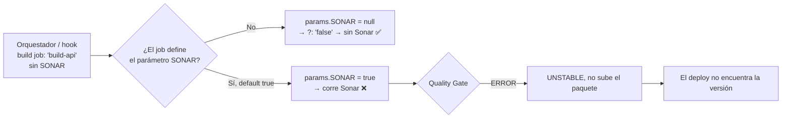

# SonarQube opcional en los builds: el default del job le gana al del código

Un patrón común: el análisis de SonarQube con Quality Gate se activa con un parámetro `SONAR`, y si el gate falla el build **no sube el paquete** al repositorio de artefactos. La intención es que el análisis corra en un **job nocturno** y que los builds normales (los que disparan los deploys) vayan sin Sonar. Pero un día un deploy falla con "no se encontró la versión", porque el build quedó `UNSTABLE` con `Quality Gate ERROR - no se subió a Artifactory`.

---

## El patrón en el código

```groovy
// En el Jenkinsfile del build: Sonar apagado si no viene el parámetro
def runSonar = (params.SONAR ?: "false").toString().trim().equalsIgnoreCase("true")

if (runSonar) {
    def gate = sonarGate(scan: { /* sonar-scanner / dotnet-sonarscanner */ })
    if (!gate.ok) {
        currentBuild.result = 'UNSTABLE'
        currentBuild.description = "${version} [Sonar: Quality Gate ${gate.status} - no se subió a Artifactory]"
        return            // no publicar el paquete
    }
}
publishToArtifactory(...)
```

Y el job nocturno lo activa explícitamente al llamar a cada build:

```groovy
build job: 'backend/build-api', parameters: [booleanParam(name: 'SONAR', value: true)], wait: true, propagate: false
```

---

## La trampa: `params.SONAR ?: "false"` no es el default real

`params.SONAR ?: "false"` solo aplica si el parámetro **no existe**. Si el job tiene definido un parámetro `SONAR` (en la configuración del job, desde la UI o un `properties([parameters(...)])` anterior), **Jenkins siempre completa `params.SONAR` con el default del job** cuando otro job lo dispara sin pasarlo:



Por eso el problema aparece "a veces": solo en los componentes cuyo job tiene `SONAR` con default `true`, y solo cuando su Quality Gate da ERROR.

---

## Auditar todos los jobs (Script Console, solo lectura)

```groovy
import jenkins.model.Jenkins
import hudson.model.ParametersDefinitionProperty
import org.jenkinsci.plugins.workflow.job.WorkflowJob

Jenkins.instance.getAllItems(WorkflowJob).each { j ->
    def d = j.getProperty(ParametersDefinitionProperty)?.getParameterDefinition('SONAR')
    if (d) {
        def last = j.lastBuild
        def lastSonar = last?.getAction(hudson.model.ParametersAction)?.getParameter('SONAR')?.value
        println "${j.fullName} | default=${d.defaultParameterValue?.value} | último build SONAR=${lastSonar} (${last?.result})"
    }
}
return null   // evita que la consola imprima la lista entera de jobs
```

Para saber **quién** disparó cada build y con qué valor:

```groovy
def j = Jenkins.instance.getItemByFullName('carpeta/build-api')
j.builds.limit(10).each { b ->
    def s = b.getAction(hudson.model.ParametersAction)?.getParameter('SONAR')?.value
    def up = b.getCause(hudson.model.Cause.UpstreamCause)
    println "#${b.number} ${b.result} SONAR=${s} <- ${up ? up.upstreamProject + ' #' + up.upstreamBuild : b.causes*.shortDescription.join(';')}"
}
return null
```

Si los `SONAR=true` vienen solo del job nocturno, está bien. Si vienen de orquestadores o hooks, el default del job es el culpable.

---

## Corregir el default

**Por API** (con respaldo previo del `config.xml`):

```python
import re, requests
J, AUTH = "https://jenkins.ejemplo.com", ("usuario", "api-token")
pat = re.compile(r'(<hudson\.model\.BooleanParameterDefinition>\s*<name>SONAR</name>.*?<defaultValue>)true(</defaultValue>)', re.S)

for job in ["backend/build-api", "deploy/build-agent"]:
    url = f"{J}/job/" + "/job/".join(job.split("/")) + "/config.xml"
    xml = requests.get(url, auth=AUTH).text
    open(job.replace("/", "__") + ".bak.xml", "w", encoding="utf-8").write(xml)   # respaldo
    new, n = pat.subn(r"\1false\2", xml)
    if n == 1:
        r = requests.post(url, auth=AUTH, data=new.encode("utf-8"), headers={"Content-Type": "application/xml; charset=utf-8"})
        print(job, r.status_code)
```

**En el código** (más robusto): declarar el parámetro en el propio Jenkinsfile con `properties([parameters([booleanParam(name: 'SONAR', defaultValue: false)])])`, así la definición vive versionada y no depende de la UI.

---

## Recomendaciones

- **Build normal = rápido y sin gate**: compila, testea lo mínimo y publica. Un Quality Gate que bloquea la publicación convierte un problema de calidad en un problema de deploy.
- **Análisis en un job aparte** (nocturno o por PR) que pase `SONAR=true` explícitamente y reporte, sin afectar el paquete que se despliega.
- **Auditar los defaults** periódicamente con el script de arriba, sobre todo después de clonar jobs.

Relacionado: [Orquestación de despliegues](/article/jenkins/07-orquestacion-de-despliegues/), [Script Console y watchdog](/article/jenkins/11-script-console-y-watchdog/), [Troubleshooting](/article/jenkins/12-troubleshooting/).
