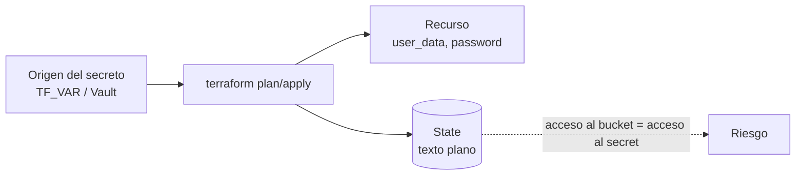

# Secretos en Terraform

## El problema

Todo valor que pasa por un recurso queda **en texto plano en el state**, aunque la variable sea `sensitive`. Eso incluye passwords de admin que viajan en `user_data`, claves de Object Storage escritas por cloud-init y outputs.



Conclusión: el **bucket del state es un activo sensible** (cifrado, versionado, acceso mínimo, nunca en Git).

---

## Nivel 1 — Nunca en el código: `TF_VAR_`

```hcl
variable "admin_password" {
  type      = string
  sensitive = true          # oculta el valor en plan/apply/logs
}
```

```hcl
# terragrunt.hcl — los secretos NO van en inputs
inputs = {
  project_name = "drp"
  # admin_password: exportar TF_VAR_admin_password antes de correr
}
```

```bash
export TF_VAR_admin_password="$(pass show infra/drp/admin)"   # o desde un gestor de contraseñas
export TF_VAR_git_deploy_key="$(cat ~/.ssh/iac_deploy_key)"
terragrunt apply
```

### Placeholder para que `plan` no pida input en CI

```hcl
inputs = {
  admin_password = get_env("TF_VAR_admin_password", "placeholder-solo-para-plan")
}
```

> Solo es seguro si el apply real siempre corre con la variable definida. Agregar una `validation` que rechace el placeholder en `apply` o un check en el pipeline.

---

## Nivel 2 — Leer desde Vault

```hcl
provider "vault" {
  address = "https://vault.miorg.local:8200"
  # token desde VAULT_TOKEN o auth_login (AppRole/JWT en CI)
}

data "vault_kv_secret_v2" "db" {
  mount = "secret"
  name  = "qa/sqlserver"
}

resource "oci_core_instance" "db" {
  # ...
  metadata = {
    user_data = base64encode(templatefile("${path.module}/bootstrap.ps1.tpl", {
      sa_password = data.vault_kv_secret_v2.db.data["sa_password"]
    }))
  }
}
```

En la configuración de entorno se guarda **la ruta**, no el valor:

```hcl
# env.hcl
db = {
  sa_password_vault_mount = "secret"
  sa_password_vault_path  = "qa/sqlserver"
}
```

> El valor leído igual termina en el state. Vault resuelve "dónde vive el secreto y quién lo rota", no "qué guarda el state".

### Credenciales dinámicas de nube

```bash
CREDS=$(vault read -format=json aws/creds/terraform-role)
export AWS_ACCESS_KEY_ID=$(jq -r .data.access_key <<<"$CREDS")
export AWS_SECRET_ACCESS_KEY=$(jq -r .data.secret_key <<<"$CREDS")
terragrunt run --all -- plan
```

Expiran solas al terminar el TTL: nadie tiene claves permanentes de admin.

### Valores efímeros (Terraform ≥ 1.10)

`ephemeral` resources y variables no se persisten en plan ni state; útiles para tokens que solo necesita el provider. Verificar soporte del provider antes de adoptarlo.

---

## Secretos en `user_data` / cloud-init

Patrón usado para bootstrap de hosts: el secreto viaja en `user_data` y cloud-init lo escribe en un archivo `0600` fuera del repo.

```yaml
#cloud-config
write_files:
  - path: /etc/drp/object-storage.env
    permissions: "0600"
    owner: root:root
    content: |
      AWS_ACCESS_KEY_ID=${access_key_id}
      AWS_SECRET_ACCESS_KEY=${secret_access_key}
```

Riesgos y mitigaciones:

| Riesgo | Mitigación |
|--------|-----------|
| `user_data` legible desde la metadata de la instancia (IMDS) | Restringir IMDS; usar claves de alcance mínimo (un bucket) |
| Queda en el state | Proteger el bucket de state |
| Rotar implica recrear | Rotar la clave en origen y actualizar el archivo en el host; `ignore_changes = [metadata["user_data"]]` |

Alternativa más limpia: **instance principals / IAM roles** (la instancia se autentica sola, sin claves): `aws_iam_instance_profile` en AWS, *dynamic groups + policies* en OCI.

---

## El state

| Control | AWS (S3) | OCI Object Storage |
|---------|----------|--------------------|
| Cifrado | `encrypt = true` (SSE) | Cifrado por defecto (Oracle-managed o KMS) |
| Versionado | `versioning { enabled = true }` | `versioning = "Enabled"` |
| Acceso | Bucket policy al rol de Terraform + `aws:SecureTransport` | Policy IAM al grupo de Terraform, `access_type = "NoPublicAccess"` |
| Locking | DynamoDB o `use_lockfile` | `use_lockfile = true` |
| Borrado accidental | `prevent_destroy`, deny `s3:DeleteBucket` | `prevent_destroy` |

```hcl
# Forzar TLS en el bucket del state (AWS)
{
  Sid       = "RequireSecureTransport"
  Effect    = "Deny"
  Principal = "*"
  Action    = "s3:*"
  Resource  = [aws_s3_bucket.state.arn, "${aws_s3_bucket.state.arn}/*"]
  Condition = { Bool = { "aws:SecureTransport" = "false" } }
}
```

---

## Cuando ya hay secretos en el repo

Hallazgos típicos en una auditoría de un repo de IaC: certificados `.pfx`/`.pem`, `password.txt`, `-secret` de agentes de CI, claves públicas/privadas, IDs de cuentas.

| Prioridad | Acción |
|-----------|--------|
| Crítica | **Rotar** todo lo expuesto (borrar el archivo no alcanza) |
| Crítica | Migrar a Vault (`secret/infrastructure/...`) y referenciar por ruta |
| Alta | Limpiar historial: `git filter-repo --path keys/ --invert-paths` + force push coordinado |
| Alta | `.gitignore`: `*.tfstate*`, `.terragrunt-cache/`, `*.pem`, `*.pfx`, `*.key`, `.env` |
| Media | Pre-commit con `gitleaks` / `trufflehog` |
| Baja | Secretos dinámicos (AWS/DB) con TTL |

```bash
# Escaneo rápido
gitleaks detect --source . --redact
```
