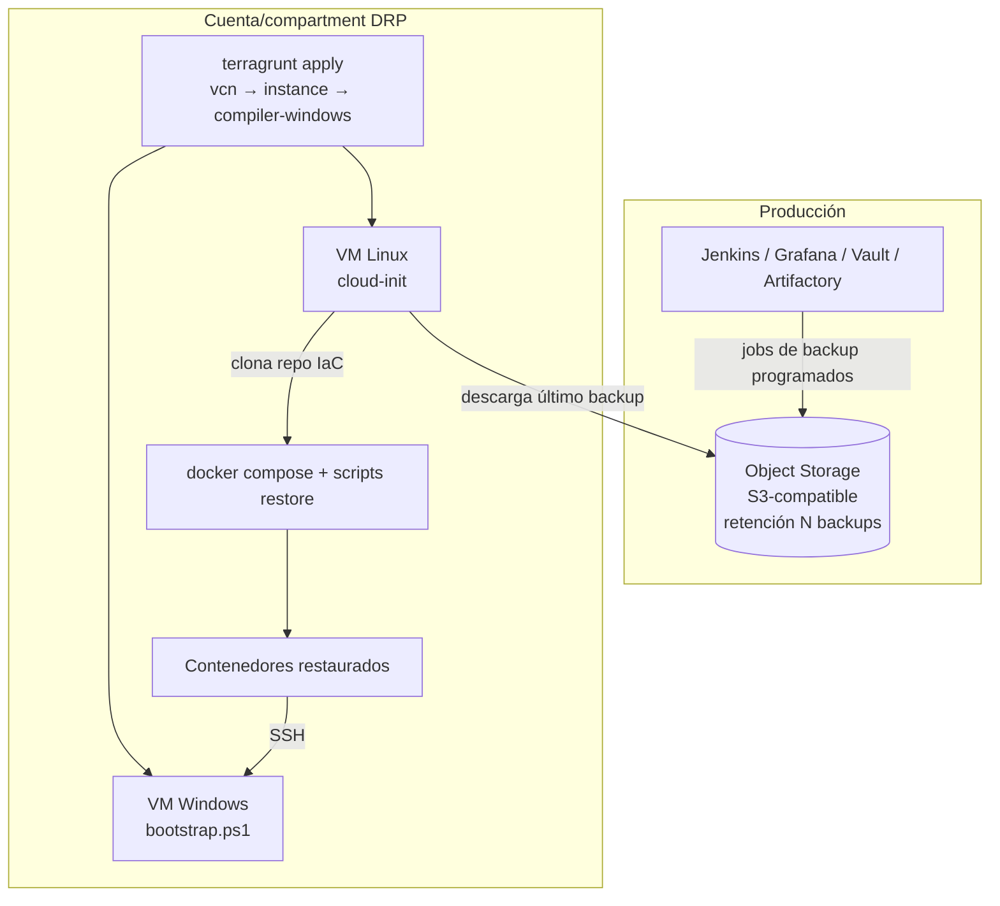

# Disaster Recovery con Terraform

## Dos problemas distintos

| | DR del **state** | DR de la **infraestructura** |
|-|------------------|------------------------------|
| Qué se perdió | El archivo que mapea código ↔ recursos | Los recursos (región caída, cuenta comprometida) |
| Herramienta | Versionado del bucket, import | Terraform + bootstrap + backups de datos |
| Objetivo | Volver a poder hacer `plan` sin recrear todo | Levantar el servicio en otro lugar en N horas |

---

## Parte 1 — Recuperar el state

### Volver a una versión anterior (S3)

```bash
aws s3api list-object-versions --bucket <state-bucket> --prefix qa/web/terraform.tfstate \
  --query 'Versions[].{id:VersionId,date:LastModified,size:Size}' --output table

aws s3api get-object --bucket <state-bucket> --key qa/web/terraform.tfstate \
  --version-id <VERSION_BUENA> recovered.tfstate

# Verificar antes de subir
terraform show recovered.tfstate | head
terraform state push recovered.tfstate        # requiere serial > al actual o -force
```

### OCI Object Storage

```bash
oci os object list-object-versions -bn <state-bucket> --prefix qa/web/terraform.tfstate
oci os object get -bn <state-bucket> --name qa/web/terraform.tfstate \
  --version-id <VERSION_BUENA> --file recovered.tfstate
```

### Escenarios

| Escenario | Recuperación |
|-----------|--------------|
| Apply que rompió el state | Versión anterior + `state push` |
| State borrado, recursos vivos | Restaurar versión; si no hay, `import {}` de cada recurso |
| Bucket borrado | Si había replicación: usar la réplica. Si no: recrear bucket + `import` masivo |
| Lock colgado | `terraform force-unlock <LOCK_ID>` (ver [Troubleshooting](/article/terraform/20-troubleshooting/)) |
| State local perdido (units con backend local) | No hay versionado: respaldar `terraform.tfstate` aparte o migrar a remoto |

### Prevención

```hcl
resource "oci_objectstorage_bucket" "tfstate" {
  versioning   = "Enabled"
  access_type  = "NoPublicAccess"
  lifecycle { prevent_destroy = true }
}

# Expirar versiones viejas para no acumular costo
resource "oci_objectstorage_object_lifecycle_policy" "tfstate" {
  namespace = local.namespace
  bucket    = oci_objectstorage_bucket.tfstate.name
  rules {
    name        = "expire-old-versions"
    action      = "DELETE"
    target      = "previous-object-versions"
    time_amount = 90
    time_unit   = "DAYS"
    is_enabled  = true
  }
}
```

AWS: versionado + bucket policy que deniegue `s3:DeleteBucket` + Cross-Region Replication del bucket de state.

> **El state del DR no puede vivir solo en la región/nube que querés recuperar.** Si el backend está en la región caída, no podés hacer `plan` del DR.

---

## Parte 2 — Entorno DRP reconstruible

Patrón probado: un DRP en **otra nube** (ej. producción en AWS/on-prem, DRP en OCI) que se levanta desde cero con Terraform y se autoabastece de datos.



### Componentes

| Unit Terragrunt | Contenido |
|-----------------|-----------|
| `vcn/` | VCN con subnet pública (host principal) y privada + NAT (agentes de build), NSGs separados |
| `instance/` | VM Linux Flex; `user_data` = cloud-init que instala Docker, clona el repo de IaC y dispara restores |
| `compiler-windows/` | VM Windows sin IP pública, IP privada **fija** para que la config restaurada la encuentre |

### Decisiones clave

- **Sin imagen dorada:** imagen stock + cloud-init. El "qué se instala" vive en Git, no en una AMI que se desactualiza.
- **Imagen por data source**, no OCID/AMI hardcodeado (los IDs son por región y caducan).
- **Compartment/cuenta separada** para el DRP: no mezcla costos ni permisos con clientes.
- **IP privada fija** para hosts que otra config referencia (`private_ip = cidrhost(subnet, 10)`), en vez de "known after apply".
- **Restore en cada boot** (unit systemd `oneshot`), no solo en el primer arranque: apagar/prender el DRP trae el **último** backup.
- **Excepciones a lo anterior documentadas:** datos que no se respaldan periódicamente (snapshot puntual) se restauran una sola vez desde `runcmd`, para no pisar lo generado después.
- **Shapes Flex:** se puede redimensionar CPU/RAM sin recrear. En DRP conviene RAM generosa (OOM-kill es peor que throttling de CPU).

### Ajustes post-restore

La config restaurada apunta a IPs/hosts de producción. Opciones, de peor a mejor:

| Opción | Problema |
|--------|----------|
| Editar a mano en la UI | Se pierde en el próximo restore |
| `sed` sobre XML/JSON restaurado | Frágil; sirve para reemplazar hosts simples |
| Script de inicialización de la app (ej. `init.groovy.d` en Jenkins) | Corre en cada arranque y reaplica la config del DRP |

### Runbook

```bash
# 0. Credenciales fuera del repo
export TF_VAR_git_deploy_key="$(cat ~/.ssh/iac_deploy_key)"
export TF_VAR_backup_access_key_id="..."
export TF_VAR_backup_secret_access_key="..."
export TF_VAR_compiler_windows_password="..."

# 1. Red → hosts (respetando dependencias)
cd infra/drp
terragrunt run --all -- apply

# 2. Seguir el bootstrap
ssh admin@<ip-publica> 'sudo tail -f /var/log/cloud-init-output.log'

# 3. Validar servicios
curl -s -o /dev/null -w "%{http_code}\n" http://<ip>:8080/login

# 4. Destruir al terminar la prueba (los backups siguen en Object Storage)
terragrunt run --all -- destroy
```

### Medir RTO/RPO

| Métrica | Depende de |
|---------|-----------|
| **RPO** | Frecuencia de los jobs de backup (diario → hasta 24 h de pérdida) |
| **RTO** | `apply` (~5-10 min) + cloud-init + descarga/restauración de backups (tamaño) + builds de imágenes |

Probar el DRP periódicamente: un DRP que nunca se levantó no es un DRP.
